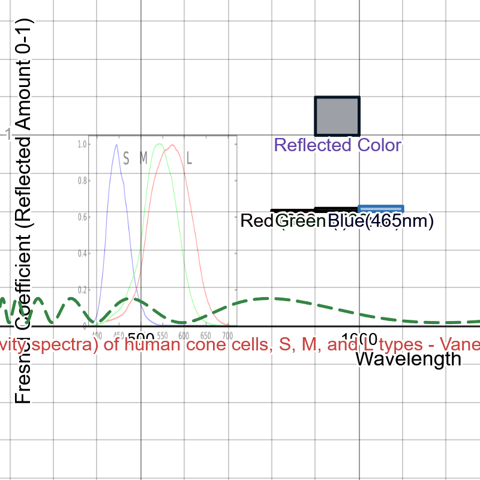
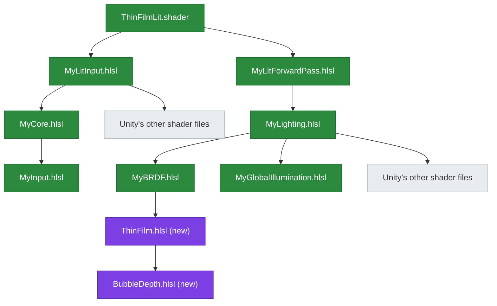

# Thin-Film Interference in Unity URP

Real-time rainbow sheen (like soap bubbles, oil slicks and bismuth crystals) added to Unity's standard URP Lit shader.

- **Built with:** Unity 6.3 LTS (6000.3.19f1) and the Universal Render Pipeline (URP)
- **Based on:** [Thin Film Interference for Computer Graphics](https://gamedev.net/tutorials/programming/graphics/thin-film-interference-for-computer-graphics-r2962) by Bacterius
- **Try the math yourself:** [Desmos graph](https://www.desmos.com/calculator/5wcoebnlgz)

## Contents

1. [How to Use This Repo](#how-to-use-this-repo)
2. [What Is Thin-Film Interference?](#what-is-thin-film-interference)
3. [The Approach](#the-approach)
4. [The Math](#the-math)
5. [Unity Integration](#unity-integration)
6. [Limitations](#limitations)
7. [Extra: Bubble Effect](#extra-bubble-effect)
8. [References](#references)

---

## How to Use This Repo

The project is split into modules. Each module folder has its own Unity scene with example objects and code. Open them in order:

1. **`Module1_ThinFilmMath`**: the thin-film math on its own
2. **`Module2_DirectSpecular`**: adding the effect to highlights from lights
3. **`Module3_EnvironmentSpecular`**: adding the effect to reflections of the surroundings
4. **`Module4_BubbleDepth`**: an animated soap-bubble effect

To start, open the project in Unity 6000.3.19f1, open a module's scene, select an object and change the settings under **Thin Film Interference** in its material.

---

## What Is Thin-Film Interference?

Light acts as a wave. When light hits a very thin transparent layer (a "thin film"), part of it reflects off the top of the layer and part reflects off the bottom. These reflected waves overlap and interact with each other. Depending on the film's thickness and the viewing angle, certain wavelengths (colors) get amplified while others get suppressed. That's why these surfaces show shifting rainbow colors.

You can see it in soap bubbles, oil or fuel on wet pavement, and bismuth crystals:

<p align="center">
  
  
  
  <br>
  <sub>Left to right: soap bubble by <a href="https://commons.wikimedia.org/wiki/File:Lipid_Islands_on_Soap_Bubble.jpg">KarlGaff</a>; diesel spill by <a href="https://commons.wikimedia.org/wiki/File:Dieselrainbow.jpg">John</a> (CC BY-SA 2.5); bismuth crystal by <a href="https://commons.wikimedia.org/wiki/File:Bismuth_crystal_macro.jpg">Dschwen</a> (CC BY 2.5). All via Wikimedia Commons.</sub>
</p>

### Project goal

Simulate this effect in real time in Unity, so it can be used in games, animation and other visual media, while keeping all the normal features of Unity's Lit shader.

### Existing work

A lot of work already exists on this topic, from research papers to hobby projects. Very realistic results have been achieved with ray tracing, and Unity's HDRP even has a built-in iridescence option. This project aims to stay as simple as possible while still looking believable, and to build it up step by step.

The math and the main idea come from **Bacterius's article** on GameDev.net, which this project is heavily based on: [Thin Film Interference for Computer Graphics](https://gamedev.net/tutorials/programming/graphics/thin-film-interference-for-computer-graphics-r2962).

---

## The Approach

A shader's job is to answer one question for every point on a surface: **what color should this point be?**

Unity's Lit shader splits the answer into two parts:

- **Diffuse:** the object's base color, from light that scatters in all directions.
- **Specular:** shiny reflections and highlights.

The specular part is scaled by the **Fresnel term**, which says how much light is reflected at a given viewing angle.

A thin film changes how much of each color gets reflected. So to add the effect, we **replace the Fresnel term with our own thin-film function**. For a given point, our function answers: *given a wavelength, a viewing angle and the materials involved, how much light is reflected?*

We run it for three wavelengths (one for red, one for green, one for blue) to get an RGB color, and use that in place of Fresnel.

<p align="center">
  <br>
  <sub>Light bouncing back and forth inside a thin film. Image: Bacterius, <a href="https://gamedev.net/tutorials/programming/graphics/thin-film-interference-for-computer-graphics-r2962">GameDev.net</a></sub>
</p>

---

## The Math

All the math lives in `ThinFilm.hlsl`, in the function `GetTFI`. For the full derivation, see Bacterius's article.

The system has three layers, each with an **index of refraction (IOR)**, a number describing how much a material slows down light:

- **n₀** (`_N0`): the outside, usually air (1.0)
- **n₁** (`_N1`): the film itself, with a thickness `_FilmDepth` in nanometers
- **n₂** (`_N2`): the object underneath

<p align="center">
  <br>
  <sub>The three layers and the angles of light in each. Image: Bacterius, <a href="https://gamedev.net/tutorials/programming/graphics/thin-film-interference-for-computer-graphics-r2962">GameDev.net</a></sub>
</p>

### Step 1: Refraction angles (Snell's Law)

Light bends when it passes into a different material. Snell's Law gives us the angle of the light inside the film (θ₁) and inside the object (θ₂):

```math
n_0 \sin\theta_0 = n_1 \sin\theta_1 = n_2 \sin\theta_2
```

```hlsl
float theta1 = asin((_N0 * sin(theta0)) / _N1);
float theta2 = asin((_N0 * sin(theta0)) / _N2);
```

### Step 2: Phase shift

Light reflected off the bottom of the film travels a little farther than light reflected off the top, so it comes back slightly out of step. How far out of step depends on the wavelength, which is why different colors get amplified or suppressed. Here is the math that calculates this phase shift in our implementation:

```math
\varphi = \frac{2\pi}{\lambda}\left(2\,n_1\,d\cos\theta_1\right) + \Delta
```

```hlsl
float numerator = 4 * PI * _N1 * depth * cos(theta1);
float delta = (_N1 > _N0 ? 0 : PI) + (_N1 > _N2 ? 0 : PI);

float phaseR = numerator / _RedSampleWL   + delta;
float phaseG = numerator / _GreenSampleWL + delta;
float phaseB = numerator / _BlueSampleWL  + delta;
```

### Step 3: Fresnel equations

Each time light hits a boundary between two materials, part of it reflects and part passes through. The Fresnel equations calculate how much. There's one pair for each of the two polarizations of light (s and p):

```math
r_s = \frac{n_i\cos\theta_i - n_j\cos\theta_j}{n_i\cos\theta_i + n_j\cos\theta_j}
\qquad
t_s = \frac{2n_i\cos\theta_i}{n_i\cos\theta_i + n_j\cos\theta_j}
```
```math
r_p = \frac{n_j\cos\theta_i - n_i\cos\theta_j}{n_i\cos\theta_j + n_j\cos\theta_i}
\qquad
t_p = \frac{2n_i\cos\theta_i}{n_i\cos\theta_j + n_j\cos\theta_i}
```

We combine these into **α** (how much light bounces around inside the film) and **β** (how much passes all the way through):

```hlsl
float alphaS = PhiS(theta1, theta0, _N1, _N0) * PhiS(theta1, theta2, _N1, _N2);
float betaS  = TauS(theta0, theta1, _N0, _N1) * TauS(theta1, theta2, _N1, _N2);
float alphaP = PhiP(theta1, theta0, _N1, _N0) * PhiP(theta1, theta2, _N1, _N2);
float betaP  = TauP(theta0, theta1, _N0, _N1) * TauP(theta1, theta2, _N1, _N2);
```

### Step 4: The final reflected amount

Putting it all together gives the amount of light transmitted through the film. Whatever isn't transmitted is reflected, and that reflected amount is our new Fresnel value:

```math
I_T = \frac{n_2\cos\theta_2}{n_0\cos\theta_0} \cdot \frac{\beta^2}{\alpha^2 - 2\alpha\cos\varphi + 1}
\qquad
I_R = 1 - I_T
```

```hlsl
float unscaledS = (betaS * betaS) / (alphaS * alphaS - 2 * alphaS * cos(phase) + 1);
float unscaledP = (betaP * betaP) / (alphaP * alphaP - 2 * alphaP * cos(phase) + 1);
float scaled = (unscaledS + unscaledP) / 2 * ((_N2 * cos(theta2)) / (_N0 * cos(theta0)));
return 1 - scaled;
```

This runs once each for red, green and blue, giving the final RGB color.

### Try it in Desmos

[This Desmos graph](https://www.desmos.com/calculator/5wcoebnlgz) runs the same math with no code. It shows how much light is reflected (0 to 1) across the whole color spectrum, and the RGB color you get from sampling it at three wavelengths. Move the sliders for thickness, IORs and angle to see how the colors change.

<p align="center">
  <br>
  <sub><a href="https://www.desmos.com/calculator/5wcoebnlgz">Open the interactive graph</a></sub>
</p>

---

## Unity Integration

Unity's Lit shader isn't one file. `Lit.shader` pulls in a tree of other shader files, and the Fresnel calculation sits a few levels down. To change it without editing Unity's own package:

1. Copy the file that contains the Fresnel calculation and change it.
2. Copy each file above it in the tree, and point it at your new copy instead of Unity's original.
3. Repeat until you reach the top `.shader` file.


<sub>Purple: new files · Green: copied and changed · Grey: Unity's files, unchanged</sub>

Each copied file keeps the same `#ifndef ..._INCLUDED` guard as Unity's original. This makes sure only our version gets used, even if another Unity file tries to include the original.

### Direct specular

This is the specular for light coming from lights in the scene. It's calculated in `LightingPhysicallyBased` in `MyLighting.hlsl`, once per light. We swap Unity's specular color for our thin-film color:

```hlsl
// Before (Unity's original)
brdf += brdfData.specular * DirectBRDFSpecular(brdfData, normalWS, lightDirectionWS, viewDirectionWS);

// After
half VoH = saturate(dot(viewDirectionWS, halfDir));
half3 filmColor = GetTFI(acos(VoH), uv);
brdf += filmColor * DirectBRDFSpecular(brdfData, normalWS, lightDirectionWS, viewDirectionWS);
```

### Environment specular

This is the specular for reflections of the surroundings (skybox and reflection probes). It's calculated in `EnvironmentBRDFSpecular` in `MyBRDF.hlsl`:

```hlsl
// Before (Unity's original)
return half3(surfaceReduction * lerp(brdfData.specular, brdfData.grazingTerm, fresnelTerm));

// After
half3 filmColor = GetTFI(acos(NoV), uv);
return half3(surfaceReduction, surfaceReduction, surfaceReduction) * filmColor;
```

### Material settings

`ThinFilmLitShaderGUI.cs` shows the thin-film settings at the top of the material, with all of Unity's normal Lit settings below.

### Full list of changed files

For readers who want the details. Beginners can skip this.

<details>
<summary>Show all files and changes</summary>

<br>

Besides swapping includes, the thin-film function needs the object's UV coordinates (to read the film thickness texture), so `uv` is passed down through several files.

| File | Change |
|---|---|
| `ThinFilm.hlsl` | **New.** The thin-film math (`GetTFI`) and its material properties |
| `BubbleDepth.hlsl` | **New.** Animated noise for the bubble effect |
| `MyBRDF.hlsl` | Includes `ThinFilm.hlsl`; new `EnvironmentBRDFSpecular` that uses the film |
| `MyLighting.hlsl` | Direct specular uses the film; passes `uv` to lighting and GI |
| `MyGlobalIllumination.hlsl` | `GlobalIllumination` takes `uv` and passes `NoV` and `uv` on |
| `MyInput.hlsl` | Adds `float2 uv` to the `InputData` struct |
| `MyCore.hlsl` | Includes `MyInput.hlsl` instead of Unity's `Input.hlsl` |
| `MyLitInput.hlsl` | Includes `MyCore.hlsl` instead of Unity's `Core.hlsl` |
| `MyLitForwardPass.hlsl` | Includes `MyLighting.hlsl`; sets `inputData.uv` |
| `ThinFilmLit.shader` | Copy of `Lit.shader` with thin-film properties; forward pass uses the files above |
| `ThinFilmLitShaderGUI.cs` | Custom material inspector |

</details>

---

## Limitations

- **Only three wavelengths are sampled.** Real light covers the whole spectrum. When the film is thick, the reflected amount changes quickly across wavelengths, and three samples can give harsh, flickering colors instead of the grey a real thick film fades to.
- **It's an approximation.** Many real-world factors are left out, such as absorption, surface roughness, and multiple film layers.
- **It's one approach of many.** It works well for certain looks (bismuth, coated lenses, oil, bubbles), but other approaches may suit other projects better.
- **Energy isn't perfectly conserved.** The diffuse color doesn't get darker when the film reflects more, so some surfaces can come out slightly too bright. This is most noticeable in transparent mode.
- **Metallic and specular colors no longer tint reflections**, since the film replaces the specular color.
- **Forward and Forward+ only.** The Deferred rendering path uses Unity's original files, so the effect won't show there.
- **Keep the outside IOR (`_N0`) the smallest.** Otherwise the math can break at steep angles.
- **Film IOR between the other two.** When the film's IOR is between the outside and object IORs (like an anti-reflective coating), the phase-shift term Δ makes the result inaccurate. The default settings aren't affected.

---

## Extra: Bubble Effect

A real soap bubble's film isn't the same thickness everywhere. Gravity pulls the liquid down, so the bubble is thicker at the bottom, and the thickness keeps swirling. Since color depends on thickness, this is what makes bubble colors move.

Turning on **Bubble Depth** in the material uses `BubbleDepth.hlsl` to fake this. It combines slowly scrolling noise with a gradient that's thicker toward the bottom:

```hlsl
float heightMod = 1 - uv.y;            // thicker toward the bottom
uv.y += _Time.y * speed;               // scroll the noise over time
uv *= scale;
return ValueNoise(uv) + heightMod;
```

With Bubble Depth off, the thickness comes from the **Film Depth Map** texture instead, so you can paint any pattern you like.

---

## References

- Bacterius, [Thin Film Interference for Computer Graphics](https://gamedev.net/tutorials/programming/graphics/thin-film-interference-for-computer-graphics-r2962), GameDev.net, 2013. The main source for this project's math and approach.
- [Thin-film math in Desmos](https://www.desmos.com/calculator/5wcoebnlgz)
- Belcour & Barla, [A Practical Extension to Microfacet Theory for the Modeling of Varying Iridescence](https://belcour.github.io/blog/research/publication/2017/05/01/brdf-thin-film.html), SIGGRAPH 2017. A more advanced model, used in Unity's HDRP.
- Wikipedia: [Thin-film interference](https://en.wikipedia.org/wiki/Thin-film_interference), [Fresnel equations](https://en.wikipedia.org/wiki/Fresnel_equations), [Snell's law](https://en.wikipedia.org/wiki/Snell%27s_law)

**Image credits:** soap bubble by KarlGaff, diesel spill by John (CC BY-SA 2.5), and bismuth crystal by Dschwen (CC BY 2.5), all via Wikimedia Commons. Thin-film diagrams by Bacterius, GameDev.net.
