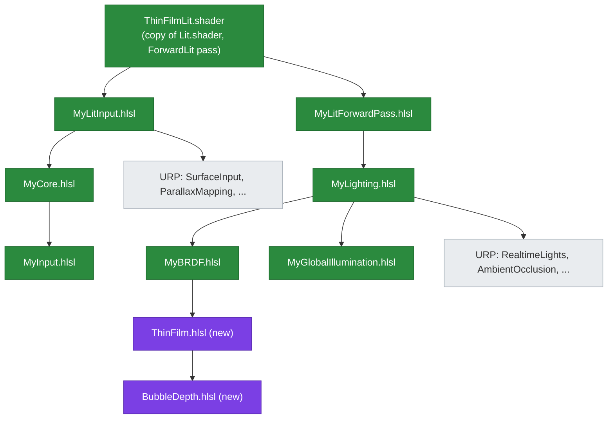

# TFI-Unity

A step-by-step, module-based introduction to rendering **thin-film interference** (the rainbow sheen on soap bubbles, oil slicks and bismuth crystals) in real time, by swapping the Fresnel term of Unity's Universal Render Pipeline (URP) Lit shader for a physically based thin-film reflectance function.

> **[Insert hero GIF here: final ThinFilmLit material on a sphere / bubble, rotating under a light]**

**Built with:** Unity 6.3 LTS (`6000.3.19f1`), URP, HLSL
**Based on:** [*Thin Film Interference for Computer Graphics*](https://gamedev.net/tutorials/programming/graphics/thin-film-interference-for-computer-graphics-r2962) by Bacterius (GameDev.net, 2013)
**Companion tool:** [Interactive Desmos graph of the thin-film math](https://www.desmos.com/calculator/5wcoebnlgz)

---

## Contents

1. [Repository Layout & Modules](#1-repository-layout--modules)
2. [Introduction](#2-introduction)
3. [The Approach: Replacing Fresnel](#3-the-approach-replacing-fresnel)
4. [The Math](#4-the-math)
   - [4.1 Refraction Angles (Snell's Law)](#41-refraction-angles-snells-law)
   - [4.2 Phase Shift](#42-phase-shift)
   - [4.3 Fresnel Equations](#43-fresnel-equations)
   - [4.4 Putting It Together](#44-putting-it-together)
   - [4.5 Explore It in Desmos](#45-explore-it-in-desmos)
5. [Unity Integration](#5-unity-integration)
   - [5.1 The Lit Shader's Include Tree](#51-the-lit-shaders-include-tree)
   - [5.2 Direct Specular](#52-direct-specular)
   - [5.3 Environment Specular](#53-environment-specular)
   - [5.4 Material Inspector](#54-material-inspector)
6. [Assumptions, Limitations & Restrictions](#6-assumptions-limitations--restrictions)
7. [Extra Effect: Bubble Film Depth](#7-extra-effect-bubble-film-depth)
8. [References](#8-references)

---

## 1. Repository Layout & Modules

Each module folder contains a Unity scene plus example code and test objects. Work through them in order.

<!-- TODO: replace folder/scene names with the actual ones in the repo -->

| # | Folder | What you'll learn | README section |
|---|--------|-------------------|----------------|
| 1 | `Module1_ThinFilmMath/` | The thin-film function on its own: film depth, IORs and wavelengths → reflected color | [§4](#4-the-math) |
| 2 | `Module2_DirectSpecular/` | Replacing Fresnel in the light loop (highlights from lights) | [§5.2](#52-direct-specular) |
| 3 | `Module3_EnvironmentSpecular/` | Replacing Fresnel in reflections (reflection probes / skybox) | [§5.3](#53-environment-specular) |
| 4 | `Module4_BubbleDepth/` | Animated, spatially varying film thickness for soap bubbles | [§7](#7-extra-effect-bubble-film-depth) |

**Quick start:** open the project in Unity `6000.3.19f1` with URP, open a module scene, select a test object, and tweak the **Thin Film Interference** section at the top of its material.

---

## 2. Introduction

### What is thin-film interference?

When light hits a transparent layer only a few hundred nanometers thick (about the size of a light wave), some of it bounces off the top surface and some passes in, bounces off the bottom surface, and comes back out. These two (and more) reflected waves overlap. Depending on how far the inner wave traveled, they line up and **reinforce** each other, or fall out of step and **cancel**.

Whether a wave is reinforced or cancelled depends on its **wavelength**, so for a given film thickness and viewing angle, some colors are reflected strongly while others nearly vanish. Change the thickness or the angle and a different set of colors wins. That is why these surfaces shimmer and shift as you move around them.

> **Metaphor:** two people walking side by side, one taking a short detour. Whether they end up in step when they meet depends on the detour's length *and* their stride. Each color of light has a different stride.

<table>
  <tr>
    <td align="center" width="33%">
      <br>
      <b>Soap bubble</b><br>
      <sub>Photo: <a href="https://commons.wikimedia.org/wiki/File:Lipid_Islands_on_Soap_Bubble.jpg">KarlGaff</a>, via Wikimedia Commons (see file page for license)</sub>
    </td>
    <td align="center" width="33%">
      <br>
      <b>Fuel slick</b><br>
      <sub>Photo: <a href="https://commons.wikimedia.org/wiki/File:Dieselrainbow.jpg">John (en:User:Guinnog)</a>, <a href="https://creativecommons.org/licenses/by-sa/2.5/">CC BY-SA 2.5</a>, via Wikimedia Commons</sub>
    </td>
    <td align="center" width="33%">
      <br>
      <b>Bismuth crystal (oxide layer)</b><br>
      <sub>Photo: <a href="https://commons.wikimedia.org/wiki/File:Bismuth_crystal_macro.jpg">Dschwen</a>, <a href="https://creativecommons.org/licenses/by/2.5/">CC BY 2.5</a>, via Wikimedia Commons</sub>
    </td>
  </tr>
</table>

### Project goal

Simulate this effect **in real time inside Unity's standard URP Lit shader**, so it can be used in games, animation and other interactive media while keeping every other Lit feature (normal maps, shadows, reflection probes, etc.).

### Existing work

There is a sizable body of work on this, from academic papers to hobby projects. Very realistic results have been achieved with spectral ray tracing, and real-time versions exist too, including in Unity: HDRP's Lit shader has an *Iridescence* material type, built on Belcour & Barla's SIGGRAPH 2017 model ([§8](#8-references)).

**What this project offers:** an approach that stays as **simple** as possible without giving up much believability, built **step by step** on top of the shader most Unity users already know.

The math and the core idea (replacing the Fresnel term) come directly from **Bacterius's article**, which this project is heavily based on. It derives the formula, explains the BRDF integration and gives reference code. Read it alongside this README:
[gamedev.net/tutorials/…/thin-film-interference-for-computer-graphics-r2962](https://gamedev.net/tutorials/programming/graphics/thin-film-interference-for-computer-graphics-r2962)

---

## 3. The Approach: Replacing Fresnel

A pixel shader answers one question over and over: **"What color should this point on the surface be?"** It gets the surface point, its normal, the direction to the camera and the lights, and must return a color.

Unity's Lit shader answers that with a **BRDF** (a function describing how a surface reflects light) made of two parts:

- **Diffuse:** light that soaks in and scatters out in all directions (the object's base color).
- **Specular:** light that bounces off the surface like a mirror (highlights and reflections).

The specular part is scaled by a **Fresnel term**: a value from 0–1 saying *how much* light is mirrored at a given angle. (It's why a lake looks clear when you look straight down but mirror-like near the horizon.)

A thin film doesn't change *where* light reflects, only *how much of each color* is reflected. So the whole effect can be added by **replacing the Fresnel term with a thin-film reflectance function**. Any BRDF that has a Fresnel term can be given a thin film this way.

Our mathematical goal is therefore to simulate the film at a single point and answer:

> *At this point, given a wavelength, an angle and the refractive indices, how much light is reflected (vs. transmitted)?*

We answer it for three wavelengths (one each for R, G and B) and plug the resulting RGB value in where Fresnel used to be.

<p align="center">
  <br>
  <sub>Light bouncing back and forth inside a thin film. Image: Bacterius, <a href="https://gamedev.net/tutorials/programming/graphics/thin-film-interference-for-computer-graphics-r2962">GameDev.net</a></sub>
</p>

---

## 4. The Math

All of this lives in **`ThinFilm.hlsl`**, entry point `GetTFI(theta0, uv)`. This section explains the concepts; see Bacterius's article for the full derivation.

We model three layers:

| Medium | Meaning | Shader property |
|---|---|---|
| 0 | Outside (usually air) | `_N0` (Ambient IOR) |
| 1 | The film (soap, oil, oxide) | `_N1` (Film IOR), thickness `_FilmDepth` in nm |
| 2 | The object underneath | `_N2` (Object IOR) |

<p align="center">
  <br>
  <sub>The single-layer setup: incident angle θ₀, angle inside the film θ₁, transmitted angle θ₂. Image: Bacterius, <a href="https://gamedev.net/tutorials/programming/graphics/thin-film-interference-for-computer-graphics-r2962">GameDev.net</a></sub>
</p>

The **IOR** (index of refraction) is how much a material slows light down: air ≈ 1.0, water ≈ 1.33, glass ≈ 1.5.

### 4.1 Refraction Angles (Snell's Law)

Light bends when it enters a material with a different IOR. Snell's law tells us the angle inside the film (θ₁) and inside the object (θ₂) from the incoming angle θ₀:

```math
n_0 \sin\theta_0 = n_1 \sin\theta_1 = n_2 \sin\theta_2
```

We need θ₁ because it sets how far light travels inside the film, and both angles for the Fresnel equations.

```hlsl
float theta1 = asin((_N0 * sin(theta0)) / _N1);
float theta2 = asin((_N0 * sin(theta0)) / _N2);
```

> **Insert image/GIF here:** a ray bending as it enters the film, with θ₀ changing and θ₁/θ₂ following.

### 4.2 Phase Shift

The **phase** of a wave is where it is in its up-and-down cycle. Each extra trip down and back up through the film delays the wave by the same amount, called φ:

```math
\varphi = \frac{2\pi}{\lambda}\left(2\,n_1\,d\cos\theta_1\right) + \Delta
```

- $`2 n_1 d \cos\theta_1`$ is the extra **optical path**: twice the thickness $`d`$, lengthened by the slant (θ₁) and by light moving slower in the film ($`n_1`$).
- Dividing by wavelength $`\lambda`$ and multiplying by $`2\pi`$ converts that distance into "how far through a cycle" the wave has shifted.
- $`\Delta`$ adds a half-cycle flip (π) for reflections off a denser material, per Bacterius. (See the note in [§6](#6-assumptions-limitations--restrictions) about this term.)

Because φ depends on λ, **each color gets a different phase**. That is the source of all the color.

```hlsl
float numerator = 4 * PI * _N1 * depth * cos(theta1);   // (2π/λ)(2·n1·d·cosθ1) with λ factored out
float delta10 = _N1 > _N0 ? 0 : PI;
float delta12 = _N1 > _N2 ? 0 : PI;
float delta   = delta10 + delta12;

float phaseR = numerator / _RedSampleWL   + delta;
float phaseG = numerator / _GreenSampleWL + delta;
float phaseB = numerator / _BlueSampleWL  + delta;
```

### 4.3 Fresnel Equations

At every boundary, the **Fresnel equations** split a wave into a reflected part ($`r`$) and a transmitted part ($`t`$). Light comes in two polarizations, *s* and *p*, which split differently, so there are four equations:

```math
r_s = \frac{n_i\cos\theta_i - n_j\cos\theta_j}{n_i\cos\theta_i + n_j\cos\theta_j}
\qquad
t_s = \frac{2n_i\cos\theta_i}{n_i\cos\theta_i + n_j\cos\theta_j}
```
```math
r_p = \frac{n_j\cos\theta_i - n_i\cos\theta_j}{n_i\cos\theta_j + n_j\cos\theta_i}
\qquad
t_p = \frac{2n_i\cos\theta_i}{n_i\cos\theta_j + n_j\cos\theta_i}
```

These are **amplitudes** (how tall the wave is), not intensities, and they can be negative. The sign matters because it determines how waves combine.

<p align="center">
  <br>
  <sub>A wave splitting at a boundary into reflected and transmitted parts. Animation: <a href="https://commons.wikimedia.org/wiki/File:Partial_transmittance.gif">Oleg Alexandrov</a>, public domain, via Wikimedia Commons</sub>
</p>

In code these are `PhiS`, `TauS`, `PhiP`, `TauP`. Following Bacterius, we combine them into two values per polarization:

- **α** = reflect off the bottom × reflect off the top: what each extra bounce inside the film multiplies the wave by.
- **β** = transmit in × transmit out: the strength of the first wave that makes it through.

```hlsl
float alphaS = PhiS(theta1, theta0, _N1, _N0) * PhiS(theta1, theta2, _N1, _N2);
float betaS  = TauS(theta0, theta1, _N0, _N1) * TauS(theta1, theta2, _N1, _N2);
float alphaP = PhiP(theta1, theta0, _N1, _N0) * PhiP(theta1, theta2, _N1, _N2);
float betaP  = TauP(theta0, theta1, _N0, _N1) * TauP(theta1, theta2, _N1, _N2);
```

### 4.4 Putting It Together

Light bounces inside the film infinitely many times, each bounce weaker by α and shifted by φ. Adding all those waves forms a geometric series with a neat closed form for the **transmitted** intensity:

```math
I_T = \underbrace{\frac{n_2\cos\theta_2}{n_0\cos\theta_0}}_{\text{beam-area / speed correction}} \cdot \frac{|\beta|^2}{|\alpha|^2 - 2\alpha\cos\varphi + 1}
```

With no absorption, whatever isn't transmitted is reflected:

```math
I_R = 1 - I_T
```

$`I_R`$ is our new Fresnel term. We compute it for *s* and *p* light, average them (assuming unpolarized light), and evaluate it once per R, G and B wavelength.

The $`\cos\varphi`$ in the denominator is the heart of the effect: as φ cycles through constructive and destructive interference, $`I_R`$ rises and falls.

```hlsl
float unscaledS = (betaS * betaS) / (alphaS * alphaS - 2 * alphaS * cos(phase) + 1);
float unscaledP = (betaP * betaP) / (alphaP * alphaP - 2 * alphaP * cos(phase) + 1);
float scaled    = (unscaledS + unscaledP) / 2 * ((_N2 * cos(theta2)) / (_N0 * cos(theta0)));
return 1 - scaled;   // reflected intensity for this wavelength
```

<p align="center">
  <br>
  <sub>Thin-film BRDF renders from Disney's BRDF Explorer. Image: Bacterius, <a href="https://gamedev.net/tutorials/programming/graphics/thin-film-interference-for-computer-graphics-r2962">GameDev.net</a></sub>
</p>

### 4.5 Explore It in Desmos

**[Open the interactive graph →](https://www.desmos.com/calculator/5wcoebnlgz)**

This graph runs the same math with no code. It plots the reflected intensity $`I_R`$ (0–1, green dashed curve) across the wavelength spectrum, overlaid on the sensitivity curves of the human eye's S, M and L cone cells, and shows the resulting RGB color from sampling the red, green and blue wavelengths. Drag the sliders for thickness, IORs and angle to see:

- why a thicker film makes the curve oscillate faster (more color bands),
- why the color shifts as the viewing angle changes,
- what the shader "sees" when it samples just three points on that curve.

<p align="center">
  <br>
  <sub>Thin-film reflectance across the visible spectrum. <a href="https://www.desmos.com/calculator/5wcoebnlgz">Interactive version on Desmos</a></sub>
</p>

> **Insert image here:** save the Desmos screenshot as `images/desmos-graph.png` (or update the path above).

---

## 5. Unity Integration

### 5.1 The Lit Shader's Include Tree

URP's `Lit.shader` is only a thin top layer. Most of its code lives in a tree of `.hlsl` include files, and the Fresnel term sits several levels deep. To change it without touching the URP package, we:

1. **Copy** the include file that contains the Fresnel code and modify it.
2. **Work up the tree:** every file that includes the original must be copied too, so it can point at our modified copy instead, all the way up to the `.shader` file.
3. Leave everything else pointing at the stock package files.


<sub>Purple: new files · Green: copied & modified · Grey: unchanged URP package files (only a few shown)</sub>

> **Tip, keep the include guards.** Each copied file keeps the original's guard (e.g. `#ifndef UNIVERSAL_BRDF_INCLUDED`). If some other URP file later tries to include the stock `BRDF.hlsl`, the guard is already defined, so the stock version is skipped and our copy wins with no duplicate-definition errors.

**Why so many files?** Besides swapping includes, the thin-film function needs the mesh **UV** (to sample the film-thickness texture), and the stock Lit shader doesn't carry UVs down into its lighting functions. So `uv` is threaded through:

| File | Change |
|---|---|
| `ThinFilm.hlsl` | **New.** The thin-film math (`GetTFI`) and its material properties |
| `BubbleDepth.hlsl` | **New.** Animated noise for bubble film thickness ([§7](#7-extra-effect-bubble-film-depth)) |
| `MyBRDF.hlsl` | Includes `ThinFilm.hlsl`; new `EnvironmentBRDFSpecular` overload using the film ([§5.3](#53-environment-specular)) |
| `MyLighting.hlsl` | Direct specular uses the film ([§5.2](#52-direct-specular)); passes `uv` to lighting & GI |
| `MyGlobalIllumination.hlsl` | `GlobalIllumination(...)` takes `uv` and passes `NoV` + `uv` to `EnvironmentBRDF` |
| `MyInput.hlsl` | Adds `float2 uv` to the `InputData` struct |
| `MyCore.hlsl` | Includes `MyInput.hlsl` instead of URP's `Input.hlsl` |
| `MyLitInput.hlsl` | Includes `MyCore.hlsl` instead of URP's `Core.hlsl` |
| `MyLitForwardPass.hlsl` | Includes `MyLighting.hlsl`; sets `inputData.uv = input.uv` |
| `ThinFilmLit.shader` | Copy of `Lit.shader`: thin-film properties, ForwardLit pass includes `MyLitInput` + `MyLitForwardPass`, custom inspector |
| `ThinFilmLitShaderGUI.cs` | Inspector: thin-film fields on top, Unity's normal Lit UI below ([§5.4](#54-material-inspector)) |

### 5.2 Direct Specular

**Where:** `LightingPhysicallyBased(...)` in `MyLighting.hlsl` (stock: `Lighting.hlsl`).
**Context:** URP calls this once per light (main light and each additional light) to compute that light's diffuse + specular contribution.

For direct light, the reflecting "micro-mirror" on the surface faces the **half vector** H (halfway between light and view), so the incident angle is the angle between **V** and **H**.

```hlsl
// BEFORE (stock URP)
brdf += brdfData.specular * DirectBRDFSpecular(brdfData, normalWS, lightDirectionWS, viewDirectionWS);

// AFTER (thin film)
float3 halfDir = SafeNormalize(lightDirectionWSFloat3 + float3(viewDirectionWS));
half   VoH     = saturate(dot(viewDirectionWS, halfDir));
half3  filmColor = GetTFI(acos(VoH), uv);
brdf += filmColor * DirectBRDFSpecular(brdfData, normalWS, lightDirectionWS, viewDirectionWS);
```

`brdfData.specular` (the base reflectance color, F0) is replaced by the RGB thin-film reflectance. `DirectBRDFSpecular` still provides the highlight's shape (GGX distribution + visibility).

**Files touched, working up the tree:** `MyLighting.hlsl` → `MyLitForwardPass.hlsl` → `ThinFilmLit.shader` (plus `MyInput`/`MyCore`/`MyLitInput` for the `uv` field).

> **Insert GIF here:** a sphere lit by a single directional light (environment reflections off), rotating the light to show the highlight changing color.

### 5.3 Environment Specular

**Where:** `EnvironmentBRDFSpecular(...)` in `MyBRDF.hlsl` (stock: `BRDF.hlsl`), called from `EnvironmentBRDF` → `GlobalIllumination` in `MyGlobalIllumination.hlsl`.
**Context:** this handles reflections of the surroundings (reflection probes and skybox). There is no single light direction here, so the incident angle is the angle between the **normal N** and **view V**.

```hlsl
// BEFORE (stock URP): approximate Fresnel blend from F0 to a grazing color
return half3(surfaceReduction * lerp(brdfData.specular, brdfData.grazingTerm, fresnelTerm));

// AFTER (thin film)
half3 filmColor = GetTFI(acos(NoV), uv);
return half3(surfaceReduction, surfaceReduction, surfaceReduction) * filmColor;
```

**Files touched, working up the tree:** `MyBRDF.hlsl` → `MyGlobalIllumination.hlsl` (new `uv` param, passes `NoV`) → `MyLighting.hlsl` → `MyLitForwardPass.hlsl` → `ThinFilmLit.shader`.

> **Insert GIF here:** the same sphere with only environment lighting (no lights, a colorful skybox or reflection probe), orbiting the camera to show colors shifting toward the edges.

### 5.4 Material Inspector

`ThinFilmLitShaderGUI.cs` draws the thin-film properties (film depth & depth map, RGB sample wavelengths, the three IORs, bubble toggle) at the top of the material, then hands the rest of the UI to Unity's internal Lit inspector via reflection, so all normal Lit options still appear. If Unity ever renames that internal class, it falls back to a plain property list.

> **Insert image here:** screenshot of the ThinFilmLit material inspector.

---

## 6. Assumptions, Limitations & Restrictions

- **Only three wavelengths are sampled.** Real light is a continuous spectrum, and the eye effectively averages the reflectance curve over it. When the curve oscillates quickly (thick films, steep angles), three samples land on essentially random points of it, giving harsh, saturated, flickering colors instead of the neutral grey that real thick films fade to. (Try this in [Desmos](https://www.desmos.com/calculator/5wcoebnlgz): increase the thickness and watch three samples try to describe a fast wiggle.) Belcour & Barla's model fixes this by pre-integrating over the spectrum ([§8](#8-references)).
- **It's an approximation.** Like all real-time rendering, this ignores many real-world factors: absorption in the film, wavelength-dependent IOR (dispersion), surface roughness under the film, multiple film layers, light polarization, and more.
- **One look among many.** This works well for specific effects (bismuth, coated lenses, oil, bubbles), but texture-based, artist-driven or spectral approaches can be just as valid for other applications.
- **Energy conservation isn't strictly followed.** The diffuse term doesn't shrink when the film reflects more, so diffuse + specular can exceed the incoming light. In transparent mode the transmitted light isn't tinted by $`I_T`$ (the complementary color), as it would be in reality.
- **The base is treated as a dielectric.** Because the film replaces the specular color entirely, the Metallic/Specular color inputs no longer tint reflections; the object underneath is described only by `_N2`.
- **The Δ phase term (note for instructors).** The signed Fresnel amplitudes already contain the half-cycle flip on reflection, so adding Δ as well double-counts it when **exactly one** interface flips, i.e. when the film's IOR lies *between* the outside and object IORs (e.g. an anti-reflective coating, `1.0 / 1.38 / 1.52`). In that case the result differs from the exact (Airy) formula; dropping Δ matches it. With the default settings (film IOR higher than both neighbors, as for bubbles and oil on water) Δ = 0 and the result is exact.
- **Total internal reflection isn't handled.** If `_N0` is larger than `_N1` or `_N2`, `asin` can receive a value > 1 at steep angles and return NaN. Keep the ambient IOR the smallest, or clamp as in Bacterius's reference code.
- **Forward / Forward+ only.** Only the ForwardLit pass uses the modified files; the GBuffer pass still uses stock URP, so with the **Deferred** rendering path the film won't appear on opaque objects.
- **Not SRP Batcher compatible.** The thin-film properties are declared outside the `UnityPerMaterial` constant buffer, so the material falls back to slower batching.

---

## 7. Extra Effect: Bubble Film Depth

Real soap films aren't uniform: gravity drains liquid downward, so a bubble is **thickest at the bottom** and the thickness constantly swirls. Since color depends on thickness, this is what makes bubble colors flow.

<p align="center">
  <br>
  <sub>A soap-bubble-like film on a ray-traced model. Image: Bacterius, <a href="https://gamedev.net/tutorials/programming/graphics/thin-film-interference-for-computer-graphics-r2962">GameDev.net</a></sub>
</p>

The shader supports two thickness sources (`PhaseShift` in `ThinFilm.hlsl`):

- **Bubble Depth off (default):** thickness = `_FilmDepth` × the red channel of `_FilmDepthMap`. Paint any variation you like into the texture.
- **Bubble Depth toggle on:** thickness comes from `GetDepthMult` in `BubbleDepth.hlsl`:

```hlsl
float heightMod = 1 - uv.y;          // larger toward the bottom of the UVs → thicker film
uv.y += _Time.y * speed;             // slowly scroll the noise over time
uv   *= scale;
return ValueNoise(uv) + heightMod;   // swirling noise + bottom-heavy gradient
```

The result is multiplied by `_FilmDepth` and capped at 1 (so the bottom saturates at the full depth), giving a slowly drifting rainbow that's busiest near the top and settles toward the bottom.

> **Insert GIF here:** a transparent bubble sphere with Bubble Depth on, showing the colors drifting.

---

## 8. References

- Bacterius. *Thin Film Interference for Computer Graphics.* GameDev.net, 2013. [Link](https://gamedev.net/tutorials/programming/graphics/thin-film-interference-for-computer-graphics-r2962). **The primary source for this project's math and approach.**
- Thin-film math visualizer (Desmos). [desmos.com/calculator/5wcoebnlgz](https://www.desmos.com/calculator/5wcoebnlgz)
- Belcour, L. & Barla, P. *A Practical Extension to Microfacet Theory for the Modeling of Varying Iridescence.* ACM Transactions on Graphics 36(4), SIGGRAPH 2017. [Project page](https://belcour.github.io/blog/research/publication/2017/05/01/brdf-thin-film.html)
- Unity HDRP documentation: Material Type, *Iridescence*. [docs.unity3d.com](https://docs.unity3d.com/Packages/hdrp/manual/Material-Type.html)
- Wikipedia: [Thin-film interference](https://en.wikipedia.org/wiki/Thin-film_interference), [Fresnel equations](https://en.wikipedia.org/wiki/Fresnel_equations), [Snell's law](https://en.wikipedia.org/wiki/Snell%27s_law), [Transfer-matrix method (optics)](https://en.wikipedia.org/wiki/Transfer-matrix_method_(optics)) (for multi-layer films)
- Unity URP source: `com.unity.render-pipelines.universal` package (`Lit.shader`, `Lighting.hlsl`, `BRDF.hlsl`, `GlobalIllumination.hlsl`)

### Image credits

- Soap bubble: KarlGaff, [Wikimedia Commons](https://commons.wikimedia.org/wiki/File:Lipid_Islands_on_Soap_Bubble.jpg)
- Diesel spill: John (en:User:Guinnog), CC BY-SA 2.5, [Wikimedia Commons](https://commons.wikimedia.org/wiki/File:Dieselrainbow.jpg)
- Bismuth crystal: Dschwen, CC BY 2.5, [Wikimedia Commons](https://commons.wikimedia.org/wiki/File:Bismuth_crystal_macro.jpg)
- Partial transmittance animation: Oleg Alexandrov, public domain, [Wikimedia Commons](https://commons.wikimedia.org/wiki/File:Partial_transmittance.gif)
- Thin-film diagrams and renders: Bacterius, [GameDev.net](https://gamedev.net/tutorials/programming/graphics/thin-film-interference-for-computer-graphics-r2962)
