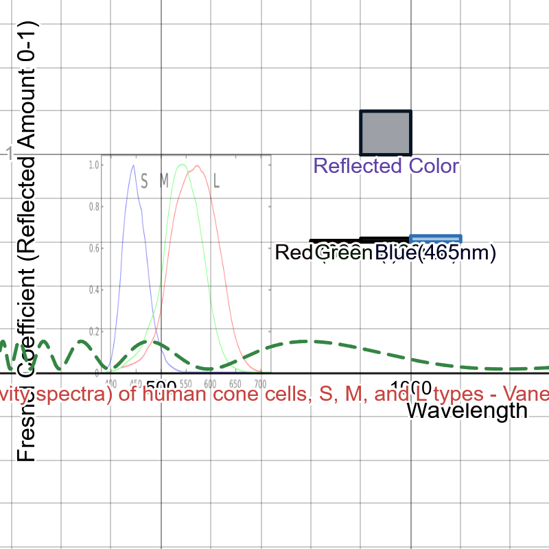
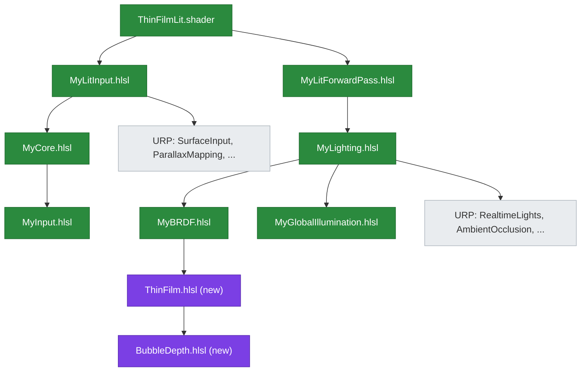

# Thin-Film Interference in Unity URP

A physically based, single-layer thin-film interference model implemented as a Fresnel replacement inside Unity's URP Lit shader. The result is real-time iridescence (soap bubbles, oil slicks, oxidized metals) that keeps every standard Lit feature.

- **Built with:** Unity 6.3 LTS (6000.3.19f1), Universal Render Pipeline (URP), HLSL
- **Based on:** [Thin Film Interference for Computer Graphics](https://gamedev.net/tutorials/programming/graphics/thin-film-interference-for-computer-graphics-r2962) by Bacterius
- **Interactive model:** [Desmos graph](https://www.desmos.com/calculator/5wcoebnlgz)

**Prerequisites:** basic HLSL, the vertex/fragment pipeline, and the idea of a microfacet BRDF (diffuse + specular, with D, G and F terms). No prior optics is assumed beyond Snell's law.

## Contents

1. [How to Use This Repo](#how-to-use-this-repo)
2. [Background](#background)
3. [The Approach](#the-approach)
4. [The Model](#the-model)
5. [URP Integration](#urp-integration)
6. [Limitations](#limitations)
7. [Extra: Bubble Film Thickness](#extra-bubble-film-thickness)
8. [Exercises](#exercises)
9. [References](#references)

---

## How to Use This Repo

The project is split into modules, each with its own scene, example objects and code:

1. **`Module1_ThinFilmMath`**: the thin-film reflectance function in isolation
2. **`Module2_DirectSpecular`**: replacing Fresnel in the per-light specular term
3. **`Module3_EnvironmentSpecular`**: replacing Fresnel in the image-based (reflection probe) specular term
4. **`Module4_BubbleDepth`**: spatially varying, animated film thickness

Open the project in Unity 6000.3.19f1 with URP set as the active render pipeline, open a module scene, and adjust the **Thin Film Interference** section of the material.

---

## Background

When light meets a transparent layer whose thickness is on the order of its wavelength (roughly 100–1000 nm), the incident wave is split at each interface into reflected and transmitted parts. Light that enters the film is reflected back and forth between its two interfaces, and each pass emits a partial wave back into the outside medium. These partial waves are mutually coherent, so they interfere. The optical path difference between successive waves determines, per wavelength, whether they interfere constructively or destructively. Under white light, the reflected spectrum is therefore selectively boosted and suppressed, producing color that varies with film thickness and viewing angle.

<p align="center">
  
  
  
  <br>
  <sub>Left to right: soap bubble by <a href="https://commons.wikimedia.org/wiki/File:Lipid_Islands_on_Soap_Bubble.jpg">KarlGaff</a>; diesel spill by <a href="https://commons.wikimedia.org/wiki/File:Dieselrainbow.jpg">John</a> (CC BY-SA 2.5); bismuth crystal by <a href="https://commons.wikimedia.org/wiki/File:Bismuth_crystal_macro.jpg">Dschwen</a> (CC BY 2.5). All via Wikimedia Commons.</sub>
</p>

### Project goal

Implement this effect in real time in Unity's URP Lit shader, so it can be used in games, animation and other visual media without giving up the features of the standard Lit material.

### Existing work

The topic is well covered, from academic work to hobby implementations. Spectral path tracers produce very accurate results, and Unity's HDRP ships an *Iridescence* material type based on Belcour & Barla (SIGGRAPH 2017), which anti-aliases the spectral response and integrates it into microfacet theory. This project prioritizes simplicity and a step-by-step build-up over that level of accuracy, while staying physically motivated.

The model and the Fresnel-replacement strategy come from **Bacterius's article** on GameDev.net, which this project follows closely: [Thin Film Interference for Computer Graphics](https://gamedev.net/tutorials/programming/graphics/thin-film-interference-for-computer-graphics-r2962). Its derivation is more detailed than the summary below.

---

## The Approach

URP's Lit shader evaluates a microfacet BRDF of the form

```math
f(\mathbf{l}, \mathbf{v}) = f_{\text{diffuse}} + \frac{D(\mathbf{h})\,G(\mathbf{l},\mathbf{v},\mathbf{h})\,F(\mathbf{v},\mathbf{h})}{4\,(\mathbf{n}\cdot\mathbf{l})(\mathbf{n}\cdot\mathbf{v})}
```

where $`D`$ is the normal distribution (GGX), $`G`$ is the shadowing/masking (visibility) term, and $`F`$ is the Fresnel reflectance: the fraction of light reflected by a microfacet with normal $`\mathbf{h}`$.

A thin film on top of a smooth base doesn't change the microfacet geometry, only how much light each facet reflects as a function of angle and wavelength. That makes it a drop-in replacement for $`F`$: substitute the thin-film reflectance $`R(\theta, \lambda)`$ for the Fresnel term and leave $`D`$ and $`G`$ untouched.

Two details make this straightforward in URP:

- **Fresnel is already per-channel.** URP stores the base reflectance (F0) as `half3 brdfData.specular`, which is how metals get colored reflections. The thin-film function returns a `half3` as well, evaluated at one representative wavelength per channel.
- **Only the phase depends on wavelength.** With constant IORs, the angles and Fresnel coefficients are shared by all three channels, so the per-channel cost is a division, a cosine and a few multiply-adds.

<p align="center">
  <br>
  <sub>Multiple reflections inside a single-layer film. Image: Bacterius, <a href="https://gamedev.net/tutorials/programming/graphics/thin-film-interference-for-computer-graphics-r2962">GameDev.net</a></sub>
</p>

---

## The Model

The full implementation is `GetTFI(theta0, uv)` in `ThinFilm.hlsl`, which returns RGB reflectance for incident angle θ₀.

### Setup

Three non-absorbing media with real refractive indices:

- **Medium 0** (`_N0`): the ambient medium, typically air
- **Medium 1** (`_N1`): the film, with thickness $`d`$ = `_FilmDepth` (nm)
- **Medium 2** (`_N2`): the substrate (the object)

<p align="center">
  <br>
  <sub>Single-layer film: θ₀ incident, θ₁ inside the film, θ₂ transmitted. Image: Bacterius, <a href="https://gamedev.net/tutorials/programming/graphics/thin-film-interference-for-computer-graphics-r2962">GameDev.net</a></sub>
</p>

### 1. Refraction angles

Snell's law relates the angles in each medium:

```math
n_0 \sin\theta_0 = n_1 \sin\theta_1 = n_2 \sin\theta_2
```

```hlsl
float theta1 = asin((_N0 * sin(theta0)) / _N1);
float theta2 = asin((_N0 * sin(theta0)) / _N2);
```

If $`n_0 > n_1`$ or $`n_0 > n_2`$, the argument of `asin` can exceed 1 (total internal reflection) and the result is NaN. The implementation assumes the ambient IOR is the smallest of the three. Bacterius's reference code instead checks $`\sin^2\theta > 1`$ and returns full reflectance.

### 2. Interface coefficients

At each interface, the Fresnel equations give the **amplitude** reflection and transmission coefficients for s- and p-polarized light, going from medium $`i`$ to medium $`j`$:

```math
r_s = \frac{n_i\cos\theta_i - n_j\cos\theta_j}{n_i\cos\theta_i + n_j\cos\theta_j}
\qquad
t_s = \frac{2n_i\cos\theta_i}{n_i\cos\theta_i + n_j\cos\theta_j}
```
```math
r_p = \frac{n_j\cos\theta_i - n_i\cos\theta_j}{n_i\cos\theta_j + n_j\cos\theta_i}
\qquad
t_p = \frac{2n_i\cos\theta_i}{n_i\cos\theta_j + n_j\cos\theta_i}
```

These are signed amplitudes, not intensities. The sign encodes a phase flip on reflection, which matters when the waves are summed. In the code, `PhiS`/`PhiP` compute $`r`$ and `TauS`/`TauP` compute $`t`$.

<p align="center">
  <br>
  <sub>Partial reflection and transmission of a wave pulse at a boundary. Animation: <a href="https://commons.wikimedia.org/wiki/File:Partial_transmittance.gif">Oleg Alexandrov</a>, public domain, via Wikimedia Commons</sub>
</p>

### 3. Phase

Each additional round trip through the film adds the same phase delay:

```math
\varphi = \frac{2\pi}{\lambda}\,\underbrace{2\,n_1\,d\cos\theta_1}_{\text{optical path difference}} + \Delta
```

The optical path difference is the extra geometric path inside the film, $`2d\cos\theta_1`$ after accounting for the lateral offset of the exiting ray, scaled by $`n_1`$ because light travels slower in the film. $`\Delta`$ is a constant phase term Bacterius adds for reflections off a higher-index medium (π per such reflection inside the film). See [Limitations](#limitations) for a caveat about this term.

```hlsl
float numerator = 4 * PI * _N1 * depth * cos(theta1);   // (2π/λ)(2 n1 d cosθ1) with λ factored out
float delta10 = _N1 > _N0 ? 0 : PI;
float delta12 = _N1 > _N2 ? 0 : PI;
float delta   = delta10 + delta12;

float phaseR = numerator / _RedSampleWL   + delta;
float phaseG = numerator / _GreenSampleWL + delta;
float phaseB = numerator / _BlueSampleWL  + delta;
```

### 4. Summing the transmitted waves

It's easier to sum the **transmitted** waves than the reflected ones, because the first reflected wave never enters the film and would need special handling. The $`k`$-th transmitted wave enters the film, makes $`k`$ round trips, and exits into the substrate. Its complex amplitude is

```math
A_k = \underbrace{t_{01}\,t_{12}}_{\beta}\;\big(\underbrace{r_{10}\,r_{12}}_{\alpha}\big)^k\,e^{ik\varphi}
```

so the total is a geometric series with ratio $`\alpha e^{i\varphi}`$, where $`|\alpha| < 1`$:

```math
\sum_{k=0}^{\infty} A_k = \frac{\beta}{1 - \alpha e^{i\varphi}}
```

Converting amplitude to transmitted power requires the factor $`\frac{n_2\cos\theta_2}{n_0\cos\theta_0}`$, which accounts for the different wave speed in the substrate ($`n`$) and the change in beam cross-section on refraction ($`\cos\theta`$). Taking the squared magnitude with real $`\alpha`$:

```math
I_T = \frac{n_2\cos\theta_2}{n_0\cos\theta_0}\cdot\frac{\beta^2}{\alpha^2 - 2\alpha\cos\varphi + 1}
```

With no absorption, energy conservation gives the reflectance:

```math
I_R = 1 - I_T
```

$`I_R`$ is evaluated separately for s- and p-polarization, then averaged under the usual assumption of unpolarized light.

```hlsl
// alpha and beta, per polarization (shared by all three wavelengths)
float alphaS = PhiS(theta1, theta0, _N1, _N0) * PhiS(theta1, theta2, _N1, _N2);
float betaS  = TauS(theta0, theta1, _N0, _N1) * TauS(theta1, theta2, _N1, _N2);
float alphaP = PhiP(theta1, theta0, _N1, _N0) * PhiP(theta1, theta2, _N1, _N2);
float betaP  = TauP(theta0, theta1, _N0, _N1) * TauP(theta1, theta2, _N1, _N2);

// GetColor, once per wavelength
float unscaledS = (betaS * betaS) / (alphaS * alphaS - 2 * alphaS * cos(phase) + 1);
float unscaledP = (betaP * betaP) / (alphaP * alphaP - 2 * alphaP * cos(phase) + 1);
float scaled    = (unscaledS + unscaledP) / 2 * ((_N2 * cos(theta2)) / (_N0 * cos(theta0)));
return 1 - scaled;
```

### 5. Sanity checks

Two limits are useful for testing an implementation:

- **$`d \to 0`$:** the film vanishes and $`I_R`$ reduces to ordinary single-interface Fresnel reflectance between media 0 and 2 (when Δ is 0 or 2π; see [Limitations](#limitations)).
- **Large $`d`$:** $`\varphi`$ varies rapidly with angle and wavelength. Averaged over φ, the interference term disappears and the result matches incoherent (geometric) optics: $`\overline{I_T} = \frac{n_2\cos\theta_2}{n_0\cos\theta_0}\cdot\frac{\beta^2}{1-\alpha^2}`$. Visually, a thick film tends toward an uncolored reflection.

<p align="center">
  
  <br>
  <sub>Left: the thin-film BRDF's polar plot at 45° incidence, differing per channel. Right: renders in Disney's BRDF Explorer. Images: Bacterius, <a href="https://gamedev.net/tutorials/programming/graphics/thin-film-interference-for-computer-graphics-r2962">GameDev.net</a></sub>
</p>

### Exploring the model in Desmos

[The Desmos graph](https://www.desmos.com/calculator/5wcoebnlgz) plots $`I_R`$ over the visible spectrum alongside the S, M and L cone sensitivity curves, and shows the RGB color produced by sampling at the three channel wavelengths. It's useful for checking intuition and debugging: thicker films make the curve oscillate faster, changing the angle shifts it, and three samples on a fast oscillation show why thick films alias.

<p align="center">
  <br>
  <sub><a href="https://www.desmos.com/calculator/5wcoebnlgz">Open the interactive graph</a></sub>
</p>

---

## URP Integration

### Where Fresnel lives in URP Lit

`Lit.shader`'s `ForwardLit` pass includes two files, `LitInput.hlsl` and `LitForwardPass.hlsl`, which pull in the rest of the shader library. Fresnel appears in two places, both in `BRDF.hlsl` and its callers:

- **Direct specular:** `LightingPhysicallyBased` (in `Lighting.hlsl`) multiplies `brdfData.specular` (F0) by `DirectBRDFSpecular`, once per light.
- **Environment specular:** `EnvironmentBRDFSpecular` (in `BRDF.hlsl`), called from `GlobalIllumination` (in `GlobalIllumination.hlsl`), blends F0 toward a grazing color for reflection-probe lighting.

### Strategy: shadow the include chain

Editing files inside the URP package isn't practical: changes are overwritten on package updates and affect every Lit material in the project. Instead, copy the files that need changes into the project and redirect includes to the copies:

1. Copy the file containing the code to change (e.g. `BRDF.hlsl` → `MyBRDF.hlsl`) and modify it.
2. Copy each file that includes it, changing its `#include` to point at the copy.
3. Repeat up to `ThinFilmLit.shader`, a copy of `Lit.shader` whose `ForwardLit` pass includes `MyLitInput.hlsl` and `MyLitForwardPass.hlsl`.


<sub>Purple: new files · Green: copied and modified · Grey: unchanged URP package files (only a few shown)</sub>

**Include guards make this work.** Each copy keeps the original's guard macro, e.g.

```hlsl
#ifndef UNIVERSAL_BRDF_INCLUDED
#define UNIVERSAL_BRDF_INCLUDED
```

Many stock URP files include `Core.hlsl`, `BRDF.hlsl` and friends themselves. As long as a copy is included before any stock file that pulls in the original, the guard is already defined when the original is reached, so the original's body is skipped and there are no duplicate definitions. This is why `MyLitInput.hlsl` includes `MyCore.hlsl` first.

### Passing UVs to the lighting code

`GetTFI` needs the surface UV to sample the film thickness map, but stock URP doesn't pass UVs into its lighting functions. The UV is threaded through as follows:

```hlsl
// MyInput.hlsl: add a field to InputData
struct InputData
{
    ...
    float2 uv;
};

// MyLitForwardPass.hlsl: InitializeInputData
inputData.uv = input.uv;

// MyLighting.hlsl: UniversalFragmentPBR passes it on
lightingData.giColor = GlobalIllumination(..., inputData.normalizedScreenSpaceUV, inputData.uv);
lightingData.mainLightColor = LightingPhysicallyBased(..., specularHighlightsOff, inputData.uv);
```

`GlobalIllumination`, `EnvironmentBRDF`, `EnvironmentBRDFSpecular` and every `LightingPhysicallyBased` overload gain a `float2 uv` parameter. `input.uv` has already been transformed by `_BaseMap`'s tiling and offset in the vertex shader, and `PhaseShift` then applies `_FilmDepthMap`'s tiling and offset on top, so the two compound.

### Direct specular

For a light, the reflecting microfacets are those with normal $`\mathbf{h}`$ (the half vector), so the incidence angle used for Fresnel is $`\theta_0 = \arccos(\mathbf{v}\cdot\mathbf{h})`$.

```hlsl
// MyLighting.hlsl, LightingPhysicallyBased

// Before (stock URP)
brdf += brdfData.specular * DirectBRDFSpecular(brdfData, normalWS, lightDirectionWS, viewDirectionWS);

// After
float3 halfDir   = SafeNormalize(lightDirectionWSFloat3 + float3(viewDirectionWS));
half   VoH       = saturate(dot(viewDirectionWS, halfDir));
half3  filmColor = GetTFI(acos(VoH), uv);
brdf += filmColor * DirectBRDFSpecular(brdfData, normalWS, lightDirectionWS, viewDirectionWS);
```

`DirectBRDFSpecular` returns a scalar: URP's "minimalist Cook-Torrance" GGX distribution multiplied by a combined approximation of visibility and Fresnel, $`V\!\cdot\!F \approx \frac{1}{(\mathbf{l}\cdot\mathbf{h})^2(\text{roughness}+0.5)}`$. Stock URP multiplies that by F0, so the change is to multiply by the angle-dependent thin-film reflectance instead.

### Environment specular

For image-based lighting there is no single light direction, so the angle comes from the normal: $`\theta_0 = \arccos(\mathbf{n}\cdot\mathbf{v})`$. Stock URP approximates the pre-integrated environment BRDF with a scale term and a blend from F0 to a grazing reflectance driven by $`(1-\mathbf{n}\cdot\mathbf{v})^4`$. That blend is replaced by the thin-film reflectance:

```hlsl
// MyBRDF.hlsl, new EnvironmentBRDFSpecular overload

// Before (stock URP)
return half3(surfaceReduction * lerp(brdfData.specular, brdfData.grazingTerm, fresnelTerm));

// After
half3 filmColor = GetTFI(acos(NoV), uv);
return half3(surfaceReduction, surfaceReduction, surfaceReduction) * filmColor;
```

`GlobalIllumination` already computes `NoV`, so it passes `NoV` and `uv` through `EnvironmentBRDF` to this overload. The original overload is kept because the clear-coat path still uses it.

### Material properties and inspector

The thin-film properties are declared in `ThinFilmLit.shader`'s `Properties` block (`_FilmDepth`, `_FilmDepthMap`, `_N0`–`_N2`, the three sample wavelengths and the `_BubbleDepth` toggle) and as global variables in `ThinFilm.hlsl`. Defaults come from the `Properties` block; the initializers in `ThinFilm.hlsl` aren't used at runtime.

`ThinFilmLitShaderGUI.cs` is a `ShaderGUI` that draws the thin-film properties first, then forwards to URP's internal Lit inspector (`UnityEditor.Rendering.Universal.ShaderGUI.LitShader`), found by reflection across loaded assemblies. That keeps the full stock Lit UI (surface type, workflow, maps) without reimplementing it. If the internal type is ever renamed, it falls back to `PropertiesDefaultGUI`.

### Full list of changed files

| File | Change |
|---|---|
| `ThinFilm.hlsl` | **New.** Material properties; `PhiS`/`TauS`/`PhiP`/`TauP`, `PhaseShift`, `GetColor`, `GetTFI` |
| `BubbleDepth.hlsl` | **New.** Value noise and `GetDepthMult` for animated film thickness |
| `MyBRDF.hlsl` | Includes `ThinFilm.hlsl`; adds `EnvironmentBRDFSpecular(brdfData, fresnelTerm, NoV, uv)`; `EnvironmentBRDF` takes `NoV` and `uv` |
| `MyLighting.hlsl` | Includes `MyBRDF.hlsl` and `MyGlobalIllumination.hlsl`; thin film in `LightingPhysicallyBased`; `uv` added to all overloads and passed from `UniversalFragmentPBR` |
| `MyGlobalIllumination.hlsl` | `GlobalIllumination` overloads take `uv`, pass `NoV` and `uv` to `EnvironmentBRDF` |
| `MyInput.hlsl` | Adds `float2 uv` to `InputData` |
| `MyCore.hlsl` | Includes `MyInput.hlsl` instead of URP's `Input.hlsl` |
| `MyLitInput.hlsl` | Includes `MyCore.hlsl` instead of URP's `Core.hlsl` |
| `MyLitForwardPass.hlsl` | Includes `MyLighting.hlsl`; sets `inputData.uv = input.uv` |
| `ThinFilmLit.shader` | Copy of `Lit.shader`: thin-film properties, `ForwardLit` pass uses `MyLitInput` + `MyLitForwardPass`, `CustomEditor "ThinFilmLitShaderGUI"` |
| `ThinFilmLitShaderGUI.cs` | Custom inspector that wraps URP's Lit inspector |

---

## Limitations

- **Spectral aliasing.** Three point samples of $`I_R(\lambda)`$ are a poor estimate of what the eye integrates over the spectrum. When φ changes quickly with λ (thick films, grazing angles), the samples land on effectively arbitrary points of the curve, giving saturated, high-frequency color where a real film would wash out toward neutral. A better approach integrates against color-matching functions, or pre-integrates analytically as Belcour & Barla do.
- **Model simplifications.** No absorption in the film, constant (non-dispersive) IORs, a single layer, unpolarized light, and both film interfaces assumed parallel to the microfacet. Real coatings rarely follow very rough surfaces exactly.
- **Energy conservation.** The diffuse term (`albedo × (1 − reflectivity)`) is independent of the film, so diffuse plus film specular can exceed the incoming energy. In transparent mode, transmitted light isn't tinted by $`I_T`$, the complement of the reflected color.
- **Fresnel partially applied twice in direct light.** URP's direct specular folds an approximation of Fresnel's angular falloff into its $`1/(\mathbf{l}\cdot\mathbf{h})^2`$ term. Multiplying by an angle-dependent $`I_R`$ applies some of that falloff again. The effect is mostly visible at grazing angles.
- **Dielectric base.** The film replaces F0 entirely, so the Metallic/Specular inputs no longer tint reflections. The substrate is described only by the real IOR `_N2`; metals would need complex IORs.
- **The Δ phase term.** The signed amplitude coefficients already encode the π shift on reflection. Adding Δ as well double-counts it whenever exactly one interface flips, i.e. when the film IOR lies between the outer and substrate IORs (as in an anti-reflective coating). For example, at 1.0 / 1.38 / 1.52 with a quarter-wave film at 550 nm, the shader gives a reflectance of 0.043 against the exact (Airy) value of 0.013. With the film IOR above both neighbors (the default 1.0 / 1.7 / 1.3, soap bubbles, oil on water), Δ = 0 and the result is exact.
- **Rendering path.** Only `ForwardLit` uses the modified includes. The `GBuffer` pass still uses stock URP, so under the Deferred rendering path opaque objects show no film.
- **SRP Batcher.** The thin-film properties are declared outside the `UnityPerMaterial` constant buffer, so the material is not SRP Batcher compatible.

---

## Extra: Bubble Film Thickness

A vertical soap film drains under gravity, so it is thinner at the top and thicker at the bottom, and convection keeps the thickness field moving. Since color depends on $`d`$, varying it over the surface and over time produces the flowing bands seen on real bubbles.

<p align="center">
  <br>
  <sub>Ray-traced model with a soap-bubble-like film. Image: Bacterius, <a href="https://gamedev.net/tutorials/programming/graphics/thin-film-interference-for-computer-graphics-r2962">GameDev.net</a></sub>
</p>

`PhaseShift` in `ThinFilm.hlsl` chooses between two thickness sources:

```hlsl
if (!_BubbleDepth)
{
    uv = TRANSFORM_TEX(uv, _FilmDepthMap);
    depth = _FilmDepth * SAMPLE_TEXTURE2D(_FilmDepthMap, sampler_FilmDepthMap, uv);
}
else
{
    depth = _FilmDepth * min(GetDepthMult(uv, 10, 0.025), 1);
}
```

With the toggle off, thickness is `_FilmDepth` scaled by the map (implicitly its red channel). With it on, `GetDepthMult` in `BubbleDepth.hlsl` adds a vertical gradient to scrolling value noise:

```hlsl
float GetDepthMult(float2 uv, float scale, float speed)
{
    float heightMod = 1 - uv.y;     // 1 at the bottom of UV space, 0 at the top
    uv.y += _Time.y * speed;        // scroll the noise over time
    uv *= scale;
    return Unity_SimpleNoise_ValueNoise_Deterministic_float(uv) + heightMod;
}
```

The noise is a smoothstep-interpolated value noise using URP's `Hash_Tchou_2_1_float` hash (the same one Shader Graph's Simple Noise node uses). The `min(..., 1)` clamp means the lower part of the surface saturates at the full `_FilmDepth`, while the upper part varies more. Because the gradient is defined in UV space, how it maps onto the surface depends on the mesh's UV layout.

---

## Exercises

These extensions work well as follow-up assignments:

1. **Fix the Δ term.** Remove Δ, then compare the result against an exact Airy reflectance in the Desmos graph or a small script, for a film IOR between its neighbors.
2. **Skip the trigonometry.** `GetTFI` converts cosines to angles (`acos`) and back (`cos`, `sin`, `asin`). Rewrite it to work on cosines directly, as Bacterius's reference code does.
3. **Handle total internal reflection.** Return full reflectance when $`\sin^2\theta > 1`$ instead of producing NaN.
4. **Reduce spectral aliasing.** Sample more wavelengths and weight them with CIE color-matching functions, or implement Belcour & Barla's Fourier-based approach.
5. **Make it SRP Batcher compatible.** Move the properties into `UnityPerMaterial`. Every pass must share the same buffer layout, so the other passes need to include the modified `MyLitInput.hlsl` too.
6. **Support Deferred.** Apply the same strategy to the `GBuffer` pass.
7. **Tint transmission.** In transparent mode, multiply transmitted light by $`I_T`$.

---

## References

- Bacterius, [Thin Film Interference for Computer Graphics](https://gamedev.net/tutorials/programming/graphics/thin-film-interference-for-computer-graphics-r2962), GameDev.net, 2013. The primary source for this project's model and approach.
- [Thin-film model in Desmos](https://www.desmos.com/calculator/5wcoebnlgz)
- L. Belcour and P. Barla, [A Practical Extension to Microfacet Theory for the Modeling of Varying Iridescence](https://belcour.github.io/blog/research/publication/2017/05/01/brdf-thin-film.html), *ACM Transactions on Graphics* 36(4), SIGGRAPH 2017.
- Unity HDRP documentation, [Material Type: Iridescence](https://docs.unity3d.com/Packages/hdrp/manual/Material-Type.html)
- Wikipedia: [Thin-film interference](https://en.wikipedia.org/wiki/Thin-film_interference), [Fresnel equations](https://en.wikipedia.org/wiki/Fresnel_equations), [Snell's law](https://en.wikipedia.org/wiki/Snell%27s_law), [Transfer-matrix method (optics)](https://en.wikipedia.org/wiki/Transfer-matrix_method_(optics)) for multi-layer films
- Unity URP package source (`com.unity.render-pipelines.universal`): `Lit.shader`, `LitForwardPass.hlsl`, `Lighting.hlsl`, `BRDF.hlsl`, `GlobalIllumination.hlsl`

**Image credits:** soap bubble by KarlGaff, diesel spill by John (CC BY-SA 2.5), bismuth crystal by Dschwen (CC BY 2.5), and wave animation by Oleg Alexandrov (public domain), all via Wikimedia Commons. Thin-film diagrams, plots and renders by Bacterius, GameDev.net.
