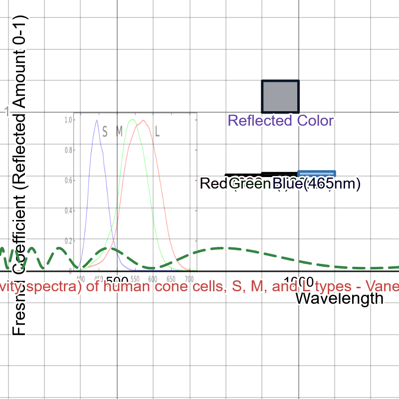
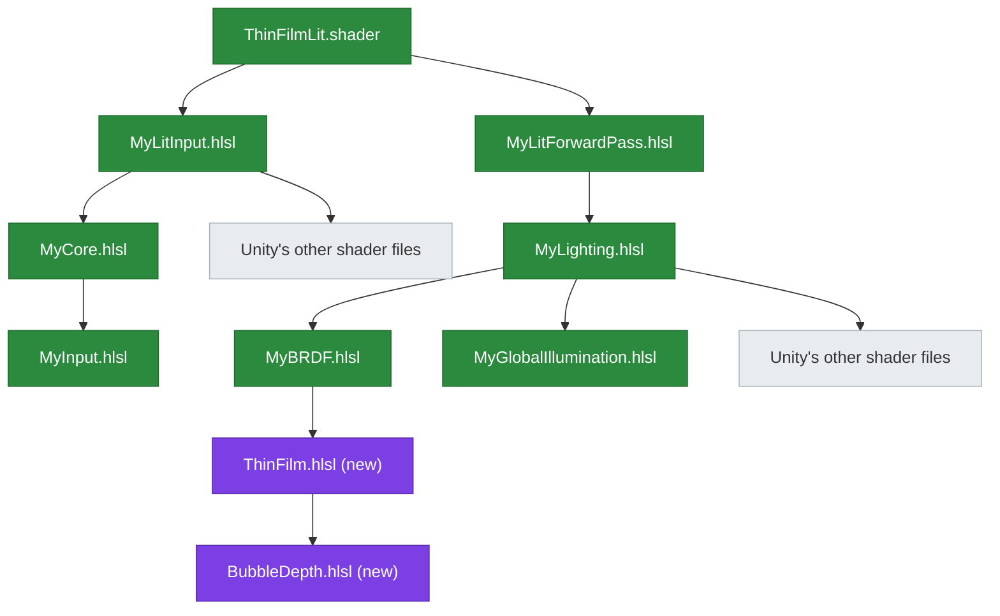

# Thin-Film Interference in Unity URP

A shader that adds the shifting rainbow sheen of soap bubbles, oil slicks and bismuth crystals to objects in Unity, in real time.

- **Built with:** Unity 6.3 LTS (6000.3.19f1) and the Universal Render Pipeline (URP)
- **Based on:** [Thin Film Interference for Computer Graphics](https://gamedev.net/tutorials/programming/graphics/thin-film-interference-for-computer-graphics-r2962) by Bacterius
- **Try the math yourself, no code needed:** [Desmos graph](https://www.desmos.com/calculator/5wcoebnlgz)

## Contents

1. [How to Use This Repo](#how-to-use-this-repo)
2. [What Is Thin-Film Interference?](#what-is-thin-film-interference)
3. [What Is a Shader?](#what-is-a-shader)
4. [The Approach](#the-approach)
5. [The Math](#the-math)
6. [Building It in Unity](#building-it-in-unity)
7. [Limitations](#limitations)
8. [Extra: Bubble Effect](#extra-bubble-effect)
9. [References](#references)

---

## How to Use This Repo

The project is split into modules. Each module folder has its own Unity scene with example objects and code. Open them in order:

1. **`Module1_ThinFilmMath`**: the thin-film math on its own
2. **`Module2_DirectSpecular`**: adding the effect to highlights from lights
3. **`Module3_EnvironmentSpecular`**: adding the effect to reflections of the surroundings
4. **`Module4_BubbleDepth`**: an animated soap-bubble effect

To start, open the project in Unity 6000.3.19f1, open a module's scene, select an object and change the settings under **Thin Film Interference** in its material.

---

## What Is Thin-Film Interference?

Light travels as a wave, and the length of that wave (its **wavelength**) is what we see as color. Red light has a longer wavelength than blue light.

A **thin film** is a transparent layer that is extremely thin, only a few hundred nanometers thick, roughly the same size as a wave of light. The wall of a soap bubble and a layer of oil floating on water are both thin films.

When light hits a thin film, part of it reflects off the top of the film and part reflects off the bottom. The two reflections overlap. Depending on the film's thickness and the angle you look from, some colors line up and get brighter, while others cancel out and fade. The colors that survive are what you see, and they shift as the thickness or viewing angle changes.

<p align="center">
  
  
  
  <br>
  <sub>Left to right: soap bubble by <a href="https://commons.wikimedia.org/wiki/File:Lipid_Islands_on_Soap_Bubble.jpg">KarlGaff</a>; diesel spill by <a href="https://commons.wikimedia.org/wiki/File:Dieselrainbow.jpg">John</a> (CC BY-SA 2.5); bismuth crystal by <a href="https://commons.wikimedia.org/wiki/File:Bismuth_crystal_macro.jpg">Dschwen</a> (CC BY 2.5). All via Wikimedia Commons.</sub>
</p>

### Project goal

Recreate this effect in real time in Unity, so it can be used in games, animation and other visual media.

### Existing work

A lot of work already exists on this topic, from research papers to hobby projects. Very realistic results have been achieved with ray tracing, and Unity's high-end render pipeline (HDRP) has a built-in iridescence option. This project aims to stay as simple as possible while still looking believable, and to build the effect up step by step.

The math and the main idea come from **Bacterius's article** on GameDev.net, which this project is heavily based on: [Thin Film Interference for Computer Graphics](https://gamedev.net/tutorials/programming/graphics/thin-film-interference-for-computer-graphics-r2962).

---

## What Is a Shader?

A 3D scene on a screen is drawn as a grid of pixels. For every pixel that shows part of an object, the computer needs to decide what color it should be.

A **shader** is a small program that makes that decision. It runs once for every point on an object's surface, many times per frame, and works out the color from things like where the lights are, where the camera is, and what the surface is made of.

Unity comes with a standard shader called **Lit**, used for most everyday objects. This project takes the Lit shader and modifies one part of it.

---

## The Approach

The Lit shader splits a surface's color into two parts:

- **Diffuse:** the object's base color, from light that scatters evenly in all directions.
- **Specular:** the shiny part, such as highlights and mirror-like reflections.

The specular part is controlled by something called the **Fresnel term**, which decides how much light gets reflected at a given viewing angle. It's the reason a window or a lake looks see-through when you look straight at it but mirror-like at a steep angle.

A thin film changes how much of *each color* gets reflected. So the effect is added by **replacing the Fresnel term with a thin-film function**. For each point on the surface, that function answers: *given a color of light, a viewing angle and the materials involved, how much light is reflected?*

The function runs for three colors (red, green and blue) to produce the final color of the reflection.

<p align="center">
  <br>
  <sub>Light reflecting off the top of a thin film and bouncing back and forth inside it. Image: Bacterius, <a href="https://gamedev.net/tutorials/programming/graphics/thin-film-interference-for-computer-graphics-r2962">GameDev.net</a></sub>
</p>

---

## The Math

You don't need to follow every equation to understand the shader. Each step below has a one-line summary of what it does, then the math and code for anyone curious. All of it lives in the file `ThinFilm.hlsl`.

The model has three layers. Each has an **index of refraction (IOR)**, a number describing how much a material slows down light (air is about 1.0, water about 1.33):

- **n₀:** the outside, usually air
- **n₁:** the film itself, with a thickness in nanometers
- **n₂:** the object underneath

<p align="center">
  <br>
  <sub>The three layers and the angle of the light in each one. Image: Bacterius, <a href="https://gamedev.net/tutorials/programming/graphics/thin-film-interference-for-computer-graphics-r2962">GameDev.net</a></sub>
</p>

### Step 1: Find the angles

Light bends when it passes into a different material. **Snell's Law** gives the angle of the light inside the film and inside the object.

```math
n_0 \sin\theta_0 = n_1 \sin\theta_1 = n_2 \sin\theta_2
```

```hlsl
float theta1 = asin((_N0 * sin(theta0)) / _N1);
float theta2 = asin((_N0 * sin(theta0)) / _N2);
```

### Step 2: Find how far out of step the reflections are

Light that reflects off the bottom of the film travels a little farther than light that reflects off the top, so it comes back slightly out of step. This is called the **phase shift**. How much it shifts depends on the color, which is why some colors get amplified and others get suppressed.

```math
\varphi = \frac{2\pi}{\lambda}\left(2\,n_1\,d\cos\theta_1\right) + \Delta
```

```hlsl
float phaseR = numerator / _RedSampleWL   + delta;
float phaseG = numerator / _GreenSampleWL + delta;
float phaseB = numerator / _BlueSampleWL  + delta;
```

### Step 3: Find how much light reflects at each surface

Every time light hits the boundary between two materials, part of it reflects and part passes through. The **Fresnel equations** calculate how much of each.

<p align="center">
  <br>
  <sub>A wave splitting at a boundary: part reflects back, part passes through. Animation: <a href="https://commons.wikimedia.org/wiki/File:Partial_transmittance.gif">Oleg Alexandrov</a>, public domain, via Wikimedia Commons</sub>
</p>

```math
r_s = \frac{n_i\cos\theta_i - n_j\cos\theta_j}{n_i\cos\theta_i + n_j\cos\theta_j}
\qquad
t_s = \frac{2n_i\cos\theta_i}{n_i\cos\theta_i + n_j\cos\theta_j}
```

```hlsl
float alphaS = PhiS(theta1, theta0, _N1, _N0) * PhiS(theta1, theta2, _N1, _N2);
float betaS  = TauS(theta0, theta1, _N0, _N1) * TauS(theta1, theta2, _N1, _N2);
```

### Step 4: Combine everything into one reflected amount

The results from the first three steps are combined into a single number between 0 and 1: how much of that color of light is reflected by the film. This number replaces the original Fresnel term.

```math
I_R = 1 - \frac{n_2\cos\theta_2}{n_0\cos\theta_0} \cdot \frac{\beta^2}{\alpha^2 - 2\alpha\cos\varphi + 1}
```

```hlsl
return 1 - scaled;   // the reflected amount for this color
```

Doing this for red, green and blue gives the color of the film at that point.

<p align="center">
  <br>
  <sub>Spheres rendered with this kind of thin-film model. Image: Bacterius, <a href="https://gamedev.net/tutorials/programming/graphics/thin-film-interference-for-computer-graphics-r2962">GameDev.net</a></sub>
</p>

### Try it in Desmos

[This Desmos graph](https://www.desmos.com/calculator/5wcoebnlgz) runs the same math with no code. It shows how much light is reflected across the whole color spectrum, and the color you get from sampling it at red, green and blue. Move the sliders for thickness, materials and angle to see the colors change.

<p align="center">
  <br>
  <sub><a href="https://www.desmos.com/calculator/5wcoebnlgz">Open the interactive graph</a></sub>
</p>

---

## Building It in Unity

Unity's Lit shader isn't one file. The main `Lit.shader` file pulls in a chain of other shader files, and the Fresnel calculation sits a few levels down in that chain. To change it without editing Unity's own files:

1. Copy the file that contains the Fresnel calculation, and change it.
2. Copy each file above it in the chain, and point it at the new copy instead of Unity's original.
3. Repeat until reaching the top `.shader` file.


<sub>Purple: new files · Green: copied and changed · Grey: Unity's files, unchanged</sub>

The Fresnel term is replaced in two places.

### Reflections of lights

This handles the bright highlights from lights in the scene. Unity's original specular color is swapped for the thin-film color:

```hlsl
// Before (Unity's original)
brdf += brdfData.specular * DirectBRDFSpecular(brdfData, normalWS, lightDirectionWS, viewDirectionWS);

// After
half3 filmColor = GetTFI(acos(VoH), uv);
brdf += filmColor * DirectBRDFSpecular(brdfData, normalWS, lightDirectionWS, viewDirectionWS);
```

### Reflections of the surroundings

This handles reflections of the sky and the rest of the scene:

```hlsl
// Before (Unity's original)
return half3(surfaceReduction * lerp(brdfData.specular, brdfData.grazingTerm, fresnelTerm));

// After
half3 filmColor = GetTFI(acos(NoV), uv);
return half3(surfaceReduction, surfaceReduction, surfaceReduction) * filmColor;
```

### Material settings

A small editor script, `ThinFilmLitShaderGUI.cs`, shows the thin-film settings (film thickness, the three IORs, the sample wavelengths and the bubble toggle) at the top of the material, with all of Unity's normal Lit settings below.

### Full list of changed files

For readers who want the details. Feel free to skip this.

| File | Change |
|---|---|
| `ThinFilm.hlsl` | **New.** The thin-film math and its settings |
| `BubbleDepth.hlsl` | **New.** Animated noise for the bubble effect |
| `MyBRDF.hlsl` | Uses the thin film for reflections of the surroundings |
| `MyLighting.hlsl` | Uses the thin film for reflections of lights |
| `MyGlobalIllumination.hlsl` | Passes the extra information the thin film needs |
| `MyInput.hlsl` | Stores the object's texture coordinates (UVs) for the thin film |
| `MyCore.hlsl` | Points at `MyInput.hlsl` instead of Unity's version |
| `MyLitInput.hlsl` | Points at `MyCore.hlsl` instead of Unity's version |
| `MyLitForwardPass.hlsl` | Points at `MyLighting.hlsl`; passes the UVs along |
| `ThinFilmLit.shader` | Copy of `Lit.shader` with the thin-film settings added |
| `ThinFilmLitShaderGUI.cs` | Shows the settings in the material |

---

## Limitations

- **Only three colors are sampled.** Real light is a continuous range of colors. With thick films, sampling just red, green and blue can give harsh, flickering colors, where a real film would fade to grey.
- **It's an approximation.** Like all real-time graphics, it leaves out many real-world details.
- **It's one approach of many.** It works well for certain looks (bismuth, oil, bubbles), but other techniques may suit other projects better.
- **Brightness isn't perfectly realistic.** Some surfaces can come out slightly too bright, especially transparent ones.
- **It only works with Unity's Forward rendering modes**, not Deferred.

---

## Extra: Bubble Effect

A real soap bubble's film isn't the same thickness everywhere. Gravity pulls the liquid down, so the bubble is thicker at the bottom, and the thickness keeps swirling around. Since color depends on thickness, this is what makes bubble colors move.

<p align="center">
  <br>
  <sub>A soap-bubble-like film on a 3D model. Image: Bacterius, <a href="https://gamedev.net/tutorials/programming/graphics/thin-film-interference-for-computer-graphics-r2962">GameDev.net</a></sub>
</p>

Turning on **Bubble Depth** in the material fakes this, using slowly scrolling random noise plus a gradient that's thicker toward the bottom:

```hlsl
float heightMod = 1 - uv.y;            // thicker toward the bottom
uv.y += _Time.y * speed;               // scroll the noise over time
return ValueNoise(uv * scale) + heightMod;
```

With Bubble Depth off, the thickness comes from an image (the **Film Depth Map**), so any pattern can be painted in.

---

## References

- Bacterius, [Thin Film Interference for Computer Graphics](https://gamedev.net/tutorials/programming/graphics/thin-film-interference-for-computer-graphics-r2962), GameDev.net, 2013. The main source for this project's math and approach.
- [Thin-film math in Desmos](https://www.desmos.com/calculator/5wcoebnlgz)
- Belcour & Barla, [A Practical Extension to Microfacet Theory for the Modeling of Varying Iridescence](https://belcour.github.io/blog/research/publication/2017/05/01/brdf-thin-film.html), SIGGRAPH 2017. A more advanced model, used in Unity's HDRP.
- Wikipedia: [Thin-film interference](https://en.wikipedia.org/wiki/Thin-film_interference), [Fresnel equations](https://en.wikipedia.org/wiki/Fresnel_equations), [Snell's law](https://en.wikipedia.org/wiki/Snell%27s_law)

**Image credits:** soap bubble by KarlGaff, diesel spill by John (CC BY-SA 2.5), bismuth crystal by Dschwen (CC BY 2.5), and wave animation by Oleg Alexandrov (public domain), all via Wikimedia Commons. Thin-film diagrams and renders by Bacterius, GameDev.net.
