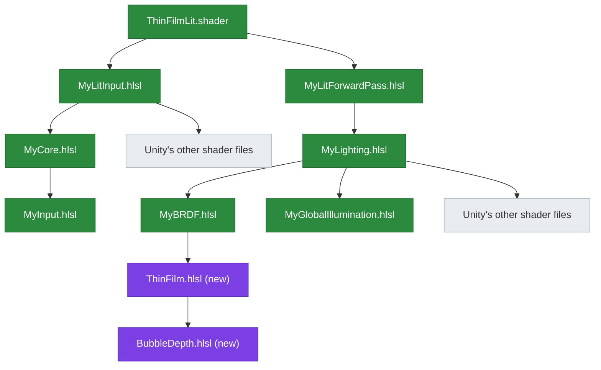

<h1 align="center">Thin-Film Interference for Unity URP</h1>

<p align="center">
  Real-time soap-bubble, oil-slick and oxidized-metal colors in Unity's Lit shader.
</p>

<p align="center">
  📷 <b>[GIF placeholder: final thin-film material, rotating under a light]</b>
</p>

<p align="center">
  <a href="#the-idea-in-two-steps">The idea</a> ·
  <a href="#step-1-the-math">Math</a> ·
  <a href="#step-2-into-the-brdf">Unity integration</a> ·
  <a href="#extra-soap-bubbles">Bubbles</a> ·
  <a href="#limitations">Limitations</a> ·
  <a href="#references">References</a>
</p>

---

## About

This is an implementation of Bacterius's [thin-film interference math](https://gamedev.net/tutorials/programming/graphics/thin-film-interference-for-computer-graphics-r2962) in Unity's URP Lit shader, plus learning materials to go with it. The goal is an effect that's easy to understand at an undergraduate level, while keeping as much realism as possible, and that slots into Unity's Lit shader without losing any of its features.

This README is a short, visual walkthrough of how it works. You don't need to know any optics, but you should be comfortable with basic shaders, BRDFs and trigonometry.

<p align="center">
  
  
  
  <br>
  <sub>Thin films in the real world: a soap bubble, a fuel spill, and a bismuth crystal's oxide layer.</sub>
</p>

**What's happening in these photos?** Each surface has a transparent layer only a few hundred nanometers thick. Light reflects off both the top and the bottom of that layer, and the two reflections overlap. Some colors line up and get stronger; others cancel out. Which colors win depends on the layer's thickness and your viewing angle, so the colors shift as you move.

### 📦 Learn by doing

Three Unity modules come with this repo. Each has scripts and scenes for learning, building and testing the code yourself:

1. **Thin-Film Math:** the thin-film function on its own
2. **Unity Integration:** putting it into the URP Lit shader
3. **Extra Effects:** the animated soap bubble, and more

Open the project in **Unity 6000.3.19f1** with URP, open a module's scene, and play with the **Thin Film Interference** settings on the test materials.

---

## The idea in two steps

**1. Approximate the thin-film math at a single point.**
Build a function that answers: *for this wavelength, angle, set of materials and film thickness, how much light is reflected?*

**2. Plug it into a BRDF.**
A BRDF already has a Fresnel term that decides how much light is reflected. Swap it for the thin-film function, and the effect appears everywhere the shader draws reflections.

---

## Step 1: The math

<sub>📦 Module 1: Thin-Film Math</sub>

📷 **[Image placeholder: draw.io diagram of the full thin-film calculation]**

The diagram above is the whole calculation, from Bacterius's article. In short:

- **Three layers:** outside (n₀), film (n₁, thickness *d*) and object (n₂), each with a refractive index (IOR).
- **Snell's law** finds the light's angle in each layer.
- **Fresnel equations** find how much light reflects and passes through at each boundary.
- **Phase** measures how far out of step the reflections are. This is the only part that depends on color.
- **The final formula** adds up every reflection into one number, *I_R*, the fraction of light reflected (0 to 1).

```math
I_R = 1 - \frac{n_2\cos\theta_2}{n_0\cos\theta_0}\cdot\frac{\beta^2}{\alpha^2 - 2\alpha\cos\varphi + 1}
```

The shader runs this for a red, a green and a blue wavelength to get the film's color.

> **What's that first fraction?** It's an energy-conservation correction for light passing *into* the object: the light changes speed, and the beam changes width as it bends. For *reflected* light it cancels out completely. It only shows up because the formula calculates transmitted light first, then subtracts it from 1. Don't worry about it too much.

### See it in Desmos

📷 **[Image placeholder: screenshot of the Desmos graph]**

[Open the graph](https://www.desmos.com/calculator/5wcoebnlgz) to try the math with no code:

- 🟢 **Dashed curve:** how much light is reflected at every wavelength
- 🔴🟢🔵 **Markers:** the three wavelengths the shader actually samples
- ⬛ **Reflected Color:** the color those three samples produce
- 👁️ **Cone curves:** how sensitive the eye's three color receptors are to each wavelength
- 🎚️ **Sliders:** film thickness, the three IORs and the viewing angle

---

## Step 2: Into the BRDF

<sub>📦 Module 2: Unity Integration</sub>

📷 **[Image placeholder: draw.io diagram of the thin-film function inside the BRDF]**

### Copying without breaking Unity

Unity's Lit shader is a tree of files. To change one deep inside without touching Unity's own package, copy it, then copy every file above it so they point at the new version:


<sub>Purple: new · Green: copied and modified · Grey: Unity's originals</sub>

Each copy keeps Unity's include guard (like `#ifndef UNIVERSAL_BRDF_INCLUDED`), so Unity's original is skipped automatically if something else tries to include it.

The Fresnel term is replaced in two places. Line numbers are for **URP 17.3.0** (Unity 6000.3).

### ☀️ Direct light

📷 **[Image placeholder: highlight before (white) vs. after (thin-film colored)]**

The highlight from a light, usually a small white spot on shiny materials, now takes on the film's color.

```hlsl
// BEFORE: Lighting.hlsl, line 60
brdf += brdfData.specular * DirectBRDFSpecular(brdfData, normalWS, lightDirectionWS, viewDirectionWS);

// AFTER: MyLighting.hlsl, lines 62–65
float3 halfDir = SafeNormalize(lightDirectionWSFloat3 + float3(viewDirectionWS));
half VoH = saturate(dot(viewDirectionWS, halfDir));   // angle between view and half vector
half3 filmColor = GetTFI(acos(VoH), uv);              // thin-film color
brdf += filmColor * DirectBRDFSpecular(brdfData, normalWS, lightDirectionWS, viewDirectionWS);
```

### 🌄 Environment reflections

📷 **[Image placeholder: sphere reflecting a skybox, before vs. after]**

Reflections of the sky and surroundings. Here Unity fakes Fresnel by blending from a "facing" color to a "grazing" color, and `fresnelTerm` is only the blend amount, not a reflectance. So the thin-film function replaces the whole blend.

It also needs the real viewing angle (`NoV`) and the surface UV (for the film thickness map), which the original function doesn't receive. That's why the function gets a new signature:

```hlsl
// BEFORE: BRDF.hlsl, lines 157–161
half3 EnvironmentBRDFSpecular(BRDFData brdfData, half fresnelTerm)
{
    float surfaceReduction = 1.0 / (brdfData.roughness2 + 1.0);
    return half3(surfaceReduction * lerp(brdfData.specular, brdfData.grazingTerm, fresnelTerm));
}

// AFTER: MyBRDF.hlsl, lines 166–172 (new overload; the original stays for clear coat)
half3 EnvironmentBRDFSpecular(BRDFData brdfData, half fresnelTerm, half NoV, float2 uv)
{
    float surfaceReduction = 1.0 / (brdfData.roughness2 + 1.0);

    half3 filmColor = GetTFI(acos(NoV), uv);   // replaces the whole lerp
    return half3(surfaceReduction, surfaceReduction, surfaceReduction) * filmColor;
}
```

### All changed files

| File | Change |
|---|---|
| `ThinFilm.hlsl` | **New.** The thin-film math (`GetTFI`) and its material properties |
| `BubbleDepth.hlsl` | **New.** Animated noise for the bubble effect |
| `MyBRDF.hlsl` | Includes `ThinFilm.hlsl`; new `EnvironmentBRDFSpecular` overload using the film |
| `MyLighting.hlsl` | Direct specular uses the film; passes `uv` to lighting and GI |
| `MyGlobalIllumination.hlsl` | `GlobalIllumination` takes `uv` and passes `NoV` and `uv` on |
| `MyInput.hlsl` | Adds `float2 uv` to the `InputData` struct |
| `MyCore.hlsl` | Includes `MyInput.hlsl` instead of Unity's `Input.hlsl` |
| `MyLitInput.hlsl` | Includes `MyCore.hlsl` instead of Unity's `Core.hlsl` |
| `MyLitForwardPass.hlsl` | Includes `MyLighting.hlsl`; sets `inputData.uv` |
| `ThinFilmLit.shader` | Copy of `Lit.shader` with thin-film properties; forward pass uses the files above |
| `ThinFilmLitShaderGUI.cs` | Custom material inspector: thin-film settings on top, Unity's Lit settings below |

---

## Extra: Soap bubbles

<sub>📦 Module 3: Extra Effects</sub>

📷 **[GIF placeholder: transparent bubble with the Bubble Depth effect]**

Same shader, set to transparent, with the film thickness read from a slowly scrolling, warping noise texture that's thicker toward the bottom. Real bubbles do this because gravity keeps draining the film downward. Turn it on with **Bubble Depth** in the material.

---

## Limitations

**Only three wavelengths are sampled**, so the color is an approximation. The biggest giveaway is colorful banding on thick films:

📷 **[GIF placeholder: Desmos graph with film thickness increasing]**

As the film gets thicker, the reflectance curve wiggles faster. A real thick film fades to grey, because each color's total reflectance evens out. With only three sample points on the curve, the shader's color jumps around instead. Sampling more wavelengths, or averaging the area under the curve, would fix this.

**Other limitations:**

- s- and p-polarized light are assumed to be equal (standard in graphics).
- No absorption, no dispersion, a single film layer, and a perfectly smooth film.
- Energy isn't strictly conserved: diffuse doesn't dim as the film reflects more, and transparent mode doesn't tint transmitted light.
- Metallic and specular colors no longer tint reflections.
- The Δ phase term is wrong when the film's IOR is between its neighbors' (like a lens coating). Bubbles and oil aren't affected.
- The outside IOR must be the smallest, or steep angles can break the math.
- Rough surfaces get brighter edge reflections than stock Lit.
- Forward and Forward+ rendering only, not Deferred.
- Not SRP Batcher compatible.

---

## References

- Bacterius, [Thin Film Interference for Computer Graphics](https://gamedev.net/tutorials/programming/graphics/thin-film-interference-for-computer-graphics-r2962), GameDev.net, 2013. The main source for this project.
- [Thin-film math in Desmos](https://www.desmos.com/calculator/5wcoebnlgz)
- Unity Technologies, [URP source code](https://github.com/Unity-Technologies/Graphics/tree/6000.3/staging/Packages/com.unity.render-pipelines.universal), Unity 6000.3 / URP 17.3.0.
- Belcour & Barla, [A Practical Extension to Microfacet Theory for the Modeling of Varying Iridescence](https://belcour.github.io/blog/research/publication/2017/05/01/brdf-thin-film.html), SIGGRAPH 2017.
- Wikipedia: [Thin-film interference](https://en.wikipedia.org/wiki/Thin-film_interference), [Fresnel equations](https://en.wikipedia.org/wiki/Fresnel_equations), [Snell's law](https://en.wikipedia.org/wiki/Snell%27s_law)

**Image credits:** soap bubble by [KarlGaff](https://commons.wikimedia.org/wiki/File:Lipid_Islands_on_Soap_Bubble.jpg), diesel spill by [John](https://commons.wikimedia.org/wiki/File:Dieselrainbow.jpg) (CC BY-SA 2.5), bismuth crystal by [Dschwen](https://commons.wikimedia.org/wiki/File:Bismuth_crystal_macro.jpg) (CC BY 2.5), all via Wikimedia Commons.
