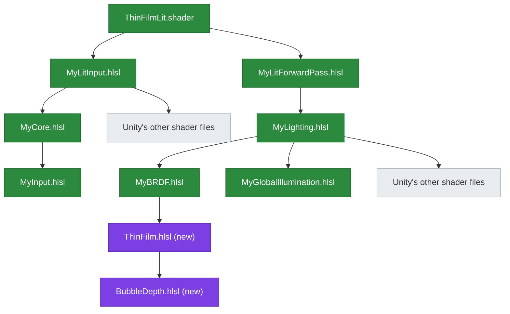

# Thin-Film Interference — URP Lit Extension

📷 **[GIF placeholder: final thin-film material, rotating under a light]**

An implementation of Bacterius's single-layer thin-film interference model ([GameDev.net, 2013](https://gamedev.net/tutorials/programming/graphics/thin-film-interference-for-computer-graphics-r2962)) as a Fresnel replacement in Unity's URP Lit shader, with Unity modules for learning and testing each part.

**Design goals**

- Understandable at an undergraduate level, with as little loss of realism as possible.
- A clean extension of URP Lit: every standard Lit feature keeps working.

**This README** is a short guide to how the effect works and how it's built, starting from zero knowledge of thin-film optics. It assumes a working understanding of shaders, BRDFs and trigonometry.

## Quick start

1. Open the project in **Unity 6000.3.19f1** with URP as the active render pipeline.
2. Open a module scene:
   - `Module1_ThinFilmMath`: scripts and scenes for the thin-film function alone
   - `Module2_UnityIntegration`: the function inside URP Lit, for direct and environment lighting
   - `Module3_ExtraEffects`: the animated soap bubble and other extensions
3. Select a test object and adjust **Thin Film Interference** on its material (`Custom/ThinFilmLit`).

## Contents

- [Overview](#overview)
- [Part 1: Thin-film reflectance at a point](#part-1-thin-film-reflectance-at-a-point)
- [Part 2: Replacing Fresnel in URP Lit](#part-2-replacing-fresnel-in-urp-lit)
- [Part 3: Bubble effect](#part-3-bubble-effect)
- [Assumptions and limitations](#assumptions-and-limitations)
- [References](#references)

---

## Overview

Thin-film interference happens when light reflects off both surfaces of a transparent layer a few hundred nanometers thick (soap film, oil on water, oxide on metal). The reflected waves interfere, amplifying some wavelengths and suppressing others depending on the film's thickness and the viewing angle.

The implementation works in two parts:

1. **Approximate the math at a discrete point.** A function `GetTFI(theta0, uv)` returns the reflected fraction of light for red, green and blue, given the incident angle, film thickness and the three IORs.
2. **Use it in the BRDF.** The function's output replaces the Fresnel term in URP Lit's specular calculations. Nothing else in the lighting model changes.

---

## Part 1: Thin-film reflectance at a point

**Module:** `Module1_ThinFilmMath` · **Code:** `ThinFilm.hlsl`

📷 **[Image placeholder: draw.io diagram of the full thin-film calculation]**

### Inputs

- `_N0`, `_N1`, `_N2`: IORs of the outside medium (usually air), the film, and the object. Defaults 1.0, 1.7, 1.3.
- `_FilmDepth`: film thickness in nanometers, scaled by `_FilmDepthMap`. Default 350.
- `_RedSampleWL`, `_GreenSampleWL`, `_BlueSampleWL`: the wavelength sampled for each channel, in nanometers. Defaults 630, 530, 465.

### Calculation

`GetTFI` runs four stages. Only the phase depends on wavelength, so the first two are computed once and shared by all three channels.

```hlsl
half3 GetTFI(float theta0, float2 uv)
{
    // 1. Snell's law: angle inside the film and inside the object
    float theta1 = asin((_N0 * sin(theta0)) / _N1);
    float theta2 = asin((_N0 * sin(theta0)) / _N2);

    // 2. Phase of each successive wave, one per R/G/B wavelength
    float3 phase = PhaseShift(theta1, uv);

    // 3. Fresnel amplitude coefficients, combined per polarization
    //    alpha = reflect(bottom) * reflect(top): strength of each internal bounce
    //    beta  = transmit(in) * transmit(out):  strength of light passing through
    float alphaS = PhiS(theta1, theta0, _N1, _N0) * PhiS(theta1, theta2, _N1, _N2);
    float betaS  = TauS(theta0, theta1, _N0, _N1) * TauS(theta1, theta2, _N1, _N2);
    float alphaP = PhiP(theta1, theta0, _N1, _N0) * PhiP(theta1, theta2, _N1, _N2);
    float betaP  = TauP(theta0, theta1, _N0, _N1) * TauP(theta1, theta2, _N1, _N2);

    // 4. Sum all waves into a reflected intensity per channel
    float red   = GetColor(_RedSampleWL,   theta0, theta2, alphaS, betaS, alphaP, betaP, phase.x);
    float green = GetColor(_GreenSampleWL, theta0, theta2, alphaS, betaS, alphaP, betaP, phase.y);
    float blue  = GetColor(_BlueSampleWL,  theta0, theta2, alphaS, betaS, alphaP, betaP, phase.z);
    return half3(red, green, blue);
}
```

Stages 2 and 4 implement these two equations from Bacterius's article:

```math
\varphi = \frac{2\pi}{\lambda}\left(2\,n_1\,d\cos\theta_1\right) + \Delta
\qquad
I_R = 1 - \frac{n_2\cos\theta_2}{n_0\cos\theta_0}\cdot\frac{\beta^2}{\alpha^2 - 2\alpha\cos\varphi + 1}
```

`GetColor` evaluates *I_R* for s- and p-polarized light and averages the two.

### Note: the beam ratio

The factor $`\frac{n_2\cos\theta_2}{n_0\cos\theta_0}`$ conserves energy for light transmitted into the object, which changes speed (the *n* ratio) and beam width (the *cos θ* ratio) as it refracts. For reflected light, it cancels out, since reflected light stays in the same medium at the same angle. It appears in the formula only because the derivation computes transmitted intensity first and takes *I_R = 1 − I_T*. It's bookkeeping, not part of the interference, so it doesn't need much attention.

### Try it: Desmos

📷 **[Image placeholder: screenshot of the Desmos graph]**

[The Desmos graph](https://www.desmos.com/calculator/5wcoebnlgz) evaluates the same equations with no code:

- **Green dashed curve:** *I_R* from 0 to 1 across wavelength.
- **R, G, B markers:** the three sample wavelengths and the reflectance at each.
- **Reflected Color:** the RGB color from those samples, matching the shader's output.
- **Cone sensitivity inset:** the eye's S, M and L cone responses, as a reference for choosing sample wavelengths.
- **Sliders:** thickness, IORs and incident angle.

Change one slider at a time and predict how the output color will move before checking.

---

## Part 2: Replacing Fresnel in URP Lit

**Module:** `Module2_UnityIntegration` · **Code:** `MyLighting.hlsl`, `MyBRDF.hlsl` and the files in the tree below

📷 **[Image placeholder: draw.io diagram of the BRDF with the thin-film function in place of Fresnel]**

### 2.1 Extend Lit without modifying the URP package

URP's Fresnel code lives several includes deep. Editing the package directly affects every Lit material and is lost on package updates. Instead:

1. Copy the file to change into the project and modify it.
2. Copy each file that includes it and redirect the `#include` to the copy.
3. Repeat up to the `.shader` file.
4. Keep each copy's original include guard (e.g. `#ifndef UNIVERSAL_BRDF_INCLUDED`). If a stock URP file later includes the original, the guard is already defined and the original is skipped.


<sub>Purple: new · Green: copied and modified · Grey: unchanged URP files</sub>

`GetTFI` also needs the surface UV for the film thickness map, which URP doesn't pass to its lighting functions. A `float2 uv` field is added to `InputData`, set in the forward pass, and passed down as a parameter.

All line numbers below refer to **URP 17.3.0** (Unity 6000.3).

### 2.2 Direct specular

**Original:** `Lighting.hlsl`, `LightingPhysicallyBased()`, line 60
**Modified:** `MyLighting.hlsl`, lines 61–65

Direct specular is the highlight from each light, the (usually white) spot on smooth, shiny materials. Replacing its Fresnel term colors that highlight with the film. The incident angle on the reflecting microfacet is the angle between the view vector **V** and the half vector **H**.

```hlsl
// Original (line 60): F0 (brdfData.specular) acts as the Fresnel term
brdf += brdfData.specular * DirectBRDFSpecular(brdfData, normalWS, lightDirectionWS, viewDirectionWS);
```

```hlsl
// Modified (lines 61–65)
float3 lightDirectionWSFloat3 = float3(lightDirectionWS);
float3 halfDir = SafeNormalize(lightDirectionWSFloat3 + float3(viewDirectionWS)); // H
half VoH = saturate(dot(viewDirectionWS, halfDir));        // cos(theta0) on the microfacet
half3 filmColor = GetTFI(acos(VoH), uv);                   // per-channel thin-film reflectance
brdf += filmColor * DirectBRDFSpecular(brdfData, normalWS, lightDirectionWS, viewDirectionWS);
```

`DirectBRDFSpecular` still supplies the highlight's shape (GGX distribution and visibility). Only its color multiplier changes.

### 2.3 Environment specular

**Original:** `BRDF.hlsl`, `EnvironmentBRDFSpecular()`, lines 157–161 (Fresnel on line 160)
**Modified:** `MyBRDF.hlsl`, new overload at lines 166–172; caller updated in `MyGlobalIllumination.hlsl`, line 519

Environment specular is the reflection of the skybox and reflection probes. Here the Fresnel term isn't a single value:

```hlsl
// Original (lines 157–161)
half3 EnvironmentBRDFSpecular(BRDFData brdfData, half fresnelTerm)
{
    float surfaceReduction = 1.0 / (brdfData.roughness2 + 1.0);
    // Fresnel = blend from F0 to a grazing color; fresnelTerm = (1 - NoV)^4 is only the weight
    return half3(surfaceReduction * lerp(brdfData.specular, brdfData.grazingTerm, fresnelTerm));
}
```

The thin-film function replaces the entire `lerp`. That requires two inputs the original signature doesn't have: the actual angle (`NoV`) and the UV. So the modified version is a new overload, and the original is kept because URP's clear-coat path still calls it.

```hlsl
// Modified (lines 166–172)
half3 EnvironmentBRDFSpecular(BRDFData brdfData, half fresnelTerm, half NoV, float2 uv)
{
    float surfaceReduction = 1.0 / (brdfData.roughness2 + 1.0);

    half3 filmColor = GetTFI(acos(NoV), uv);   // replaces lerp(F0, grazing, fresnelTerm)
    return half3(surfaceReduction, surfaceReduction, surfaceReduction) * filmColor;
}
```

```hlsl
// MyGlobalIllumination.hlsl, GlobalIllumination(), line 519: pass NoV and uv through
half3 color = EnvironmentBRDF(brdfData, indirectDiffuse, indirectSpecular, fresnelTerm, NoV, uv);
```

### 2.4 Changed files

| File | Change |
|---|---|
| `ThinFilm.hlsl` | **New.** The thin-film math (`GetTFI`) and its material properties |
| `BubbleDepth.hlsl` | **New.** Animated noise for the bubble effect |
| `MyBRDF.hlsl` | Includes `ThinFilm.hlsl`; new `EnvironmentBRDFSpecular` overload using the film |
| `MyLighting.hlsl` | Direct specular uses the film; passes `uv` to lighting and GI |
| `MyGlobalIllumination.hlsl` | `GlobalIllumination` takes `uv` and passes `NoV` and `uv` on |
| `MyInput.hlsl` | Adds `float2 uv` to the `InputData` struct |
| `MyCore.hlsl` | Includes `MyInput.hlsl` instead of Unity's `Input.hlsl` |
| `MyLitInput.hlsl` | Includes `MyCore.hlsl` instead of Unity's `Core.hlsl` |
| `MyLitForwardPass.hlsl` | Includes `MyLighting.hlsl`; sets `inputData.uv` |
| `ThinFilmLit.shader` | Copy of `Lit.shader` with thin-film properties; forward pass uses the files above |
| `ThinFilmLitShaderGUI.cs` | Custom material inspector: thin-film settings on top, Unity's Lit settings below |

---

## Part 3: Bubble effect

**Module:** `Module3_ExtraEffects` · **Code:** `BubbleDepth.hlsl`

📷 **[GIF placeholder: transparent bubble with the Bubble Depth effect]**

The same shader in transparent mode, with film thickness driven by slowly scrolling, warping noise plus a gradient that thickens toward the bottom. This approximates how gravity drains a real soap film downward, constantly shifting its thickness and color. Enable it with the **Bubble Depth** toggle.

```hlsl
float heightMod = 1 - uv.y;             // thicker toward the bottom
uv.y += _Time.y * speed;                // scroll the noise over time
uv *= scale;
return ValueNoise(uv) + heightMod;      // multiplied by _FilmDepth, capped at 1
```

---

## Assumptions and limitations

- **Unpolarized light.** s- and p-polarized results are weighted equally, the standard assumption in computer graphics.
- **Three wavelength samples.** The color is an approximation, and the most notable artifact is colorful banding as film thickness increases.

  📷 **[GIF placeholder: Desmos graph with film thickness increasing]**

  The reflectance curve oscillates faster as film thickness increases. Physically, the color should fade to greyscale as each channel's total reflectance becomes uniform. With only three sample points, the calculated color instead shifts rapidly. Sampling more wavelengths, or averaging the area under the curve per channel, would fix this.
- **Simplified film.** No absorption, constant IOR across wavelengths (no dispersion), one layer, and both film interfaces parallel to the surface.
- **Energy conservation.** Diffuse isn't reduced as film reflectance increases, and transmitted light isn't tinted in transparent mode.
- **Dielectric base.** The film replaces F0, so Metallic and Specular color inputs no longer tint reflections.
- **Δ phase term.** When the film IOR is between `_N0` and `_N2`, Δ double-counts a phase flip already in the signed Fresnel coefficients. Films with a higher IOR than both neighbors (bubbles, oil on water) are unaffected.
- **Total internal reflection.** If `_N0` exceeds `_N1` or `_N2`, `asin` can return NaN at steep angles.
- **Rough surfaces.** The environment path drops URP's roughness-based grazing term, so rough materials show brighter rims than stock Lit.
- **Rendering path.** Only the ForwardLit pass is modified, so Deferred rendering shows no film.
- **SRP Batcher.** Thin-film properties are outside `UnityPerMaterial`, so the material isn't batcher compatible.

---

## References

- Bacterius, [Thin Film Interference for Computer Graphics](https://gamedev.net/tutorials/programming/graphics/thin-film-interference-for-computer-graphics-r2962), GameDev.net, 2013. The source of the model and the Fresnel-replacement approach.
- [Thin-film math in Desmos](https://www.desmos.com/calculator/5wcoebnlgz)
- Unity Technologies, [URP source code](https://github.com/Unity-Technologies/Graphics/tree/6000.3/staging/Packages/com.unity.render-pipelines.universal), Unity 6000.3 / URP 17.3.0.
- Belcour & Barla, [A Practical Extension to Microfacet Theory for the Modeling of Varying Iridescence](https://belcour.github.io/blog/research/publication/2017/05/01/brdf-thin-film.html), SIGGRAPH 2017. Addresses spectral aliasing; used in Unity's HDRP.
- Wikipedia: [Thin-film interference](https://en.wikipedia.org/wiki/Thin-film_interference), [Fresnel equations](https://en.wikipedia.org/wiki/Fresnel_equations), [Snell's law](https://en.wikipedia.org/wiki/Snell%27s_law)
