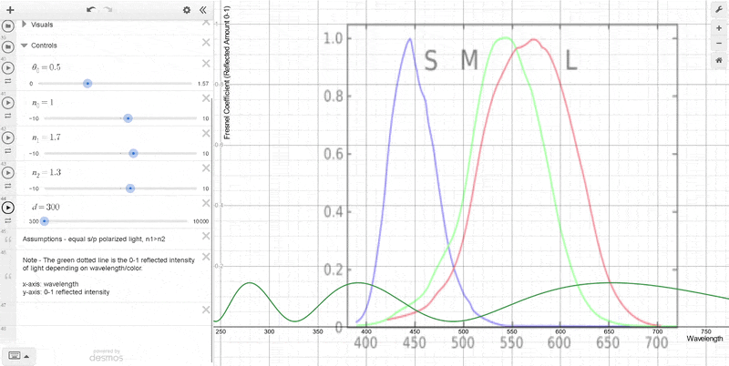
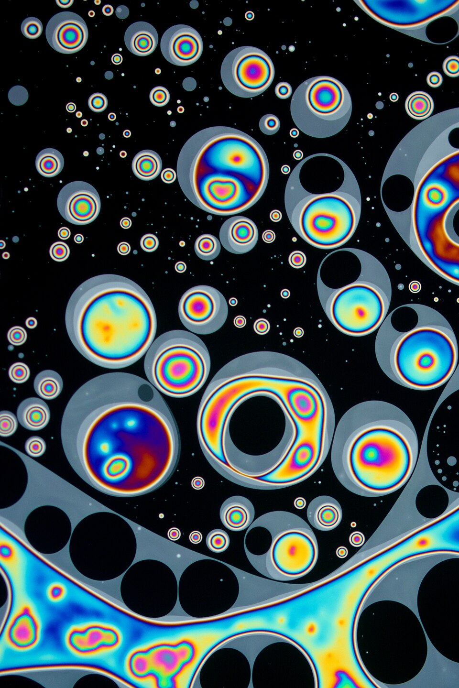
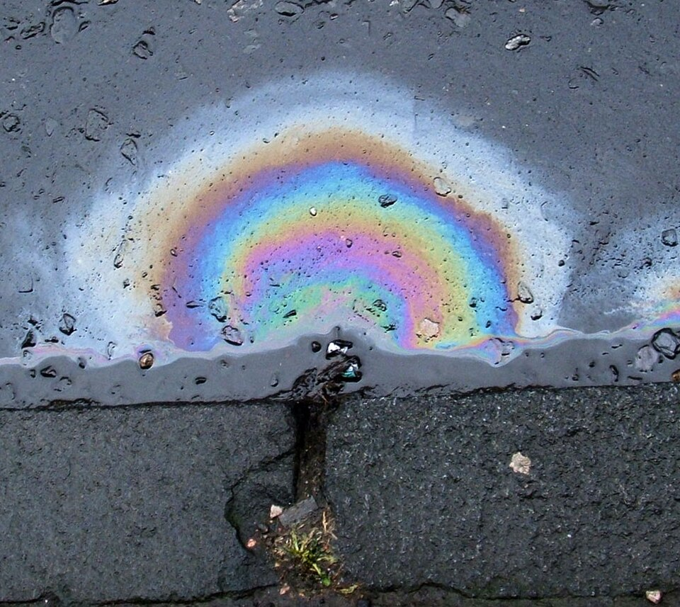
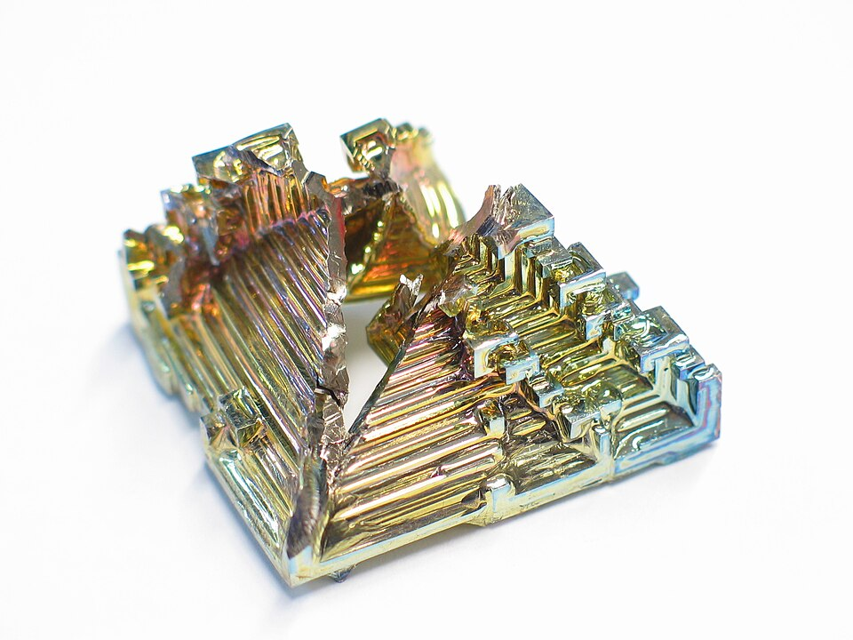
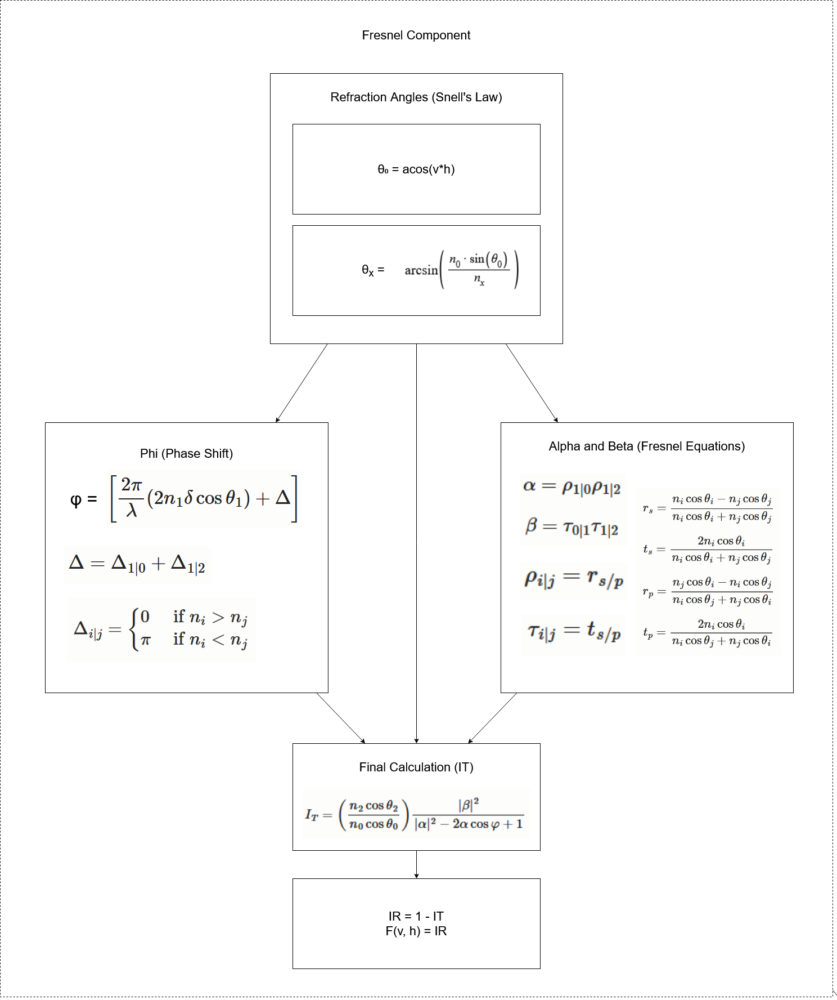
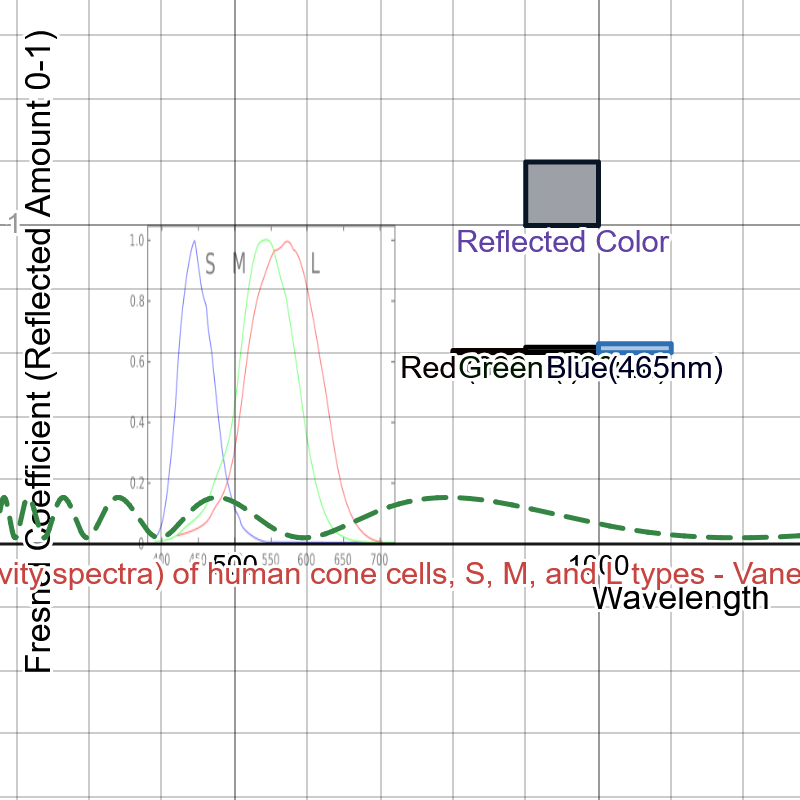
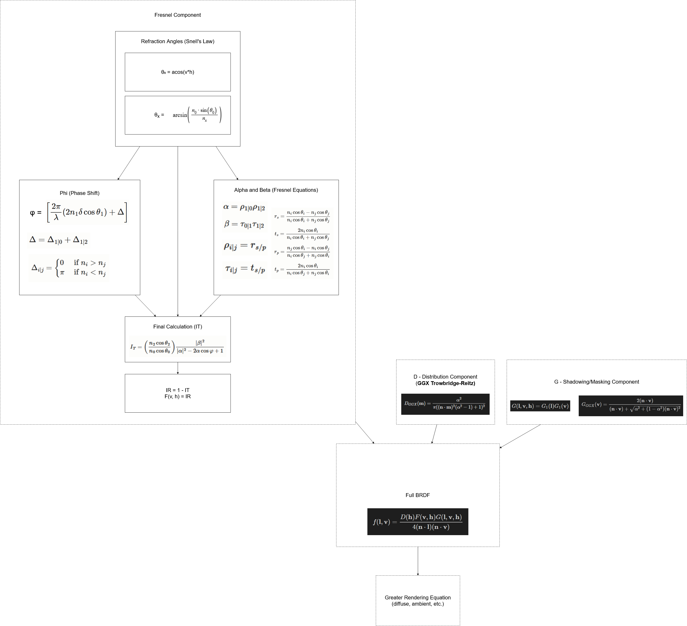
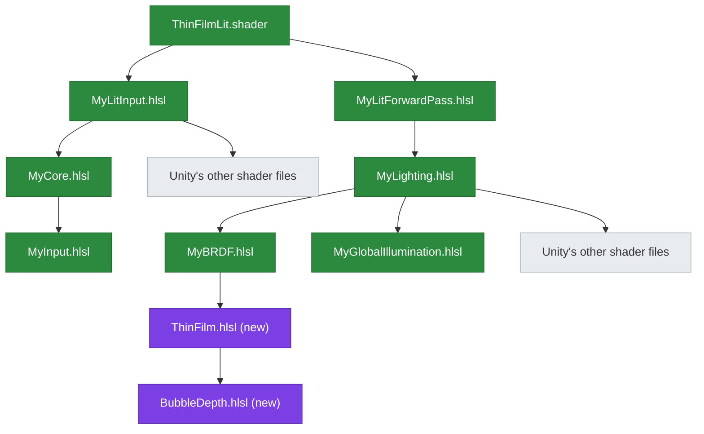

# Thin-Film Interference in Unity URP

<p align="center">
  
</p>

## Contents

1. [**Overview**](#part-1-overview): what thin-film interference is, the project, and the approach
2. [**The Math**](#part-2-the-math): calculating thin-film reflectance at a single point
3. [**Shader Integration**](#part-3-shader-integration): putting the math into Unity's URP Lit shader
4. [**Beyond the Basics**](#part-4-beyond-the-basics): the bubble effect, limitations and references

# Part 1: Overview


## What is thin-film interference?

Thin-film interference is the shifting rainbow color seen on soap bubbles, oil slicks and oxidized metals like bismuth. It happens when light reflects off both the top and bottom of a transparent layer only a few hundred nanometers thick. The reflected waves overlap, and depending on the film's thickness and the viewing angle, some wavelengths (colors) are amplified while others are suppressed.

<p align="center">
  
  
  
  <br>
  <sub>Soap bubble (KarlGaff), diesel spill (John, CC BY-SA 2.5), bismuth crystal (Dschwen, CC BY 2.5). All via Wikimedia Commons.</sub>
</p>

## What is this project?

This project implements the thin-film interference math from Bacterius's article [*Thin Film Interference for Computer Graphics*](https://gamedev.net/tutorials/programming/graphics/thin-film-interference-for-computer-graphics-r2962) inside Unity's URP Lit shader, along with supplemental educational materials. The main focus is keeping the effect simple and understandable at an undergraduate level while giving up as little realism as possible. A secondary focus is integrating cleanly with Unity's Lit shader, so the effect works alongside all of its normal features.

## What is this README?

A brief write-up, with visual examples, that explains the effect from zero knowledge of thin-film optics. It assumes a basic working understanding of shaders, BRDFs and the applicable math (trigonometry and a little algebra).

## Learning modules

The repository includes three Unity modules, each with scripts and scenes to learn, build and test the code yourself:

- **Module 1: Thin-Film Math.** The thin-film function on its own, with test scenes for each variable.
- **Module 2: Unity Integration.** Adding the function to the URP Lit shader, for both direct and environment lighting.
- **Module 3: Extra Effects.** The animated soap-bubble effect and other extensions.

Open the project in Unity 6000.3.19f1 with URP, open a module's scene, and adjust the **Thin Film Interference** settings on the test materials.

## Approach

The implementation has two steps:

1. **Approximate the thin-film math at a single point.** Write a function that answers: *given a wavelength, an incident angle, the three refractive indices and the film's thickness, how much light is reflected?*
2. **Plug that function into a BRDF.** In a standard BRDF, the Fresnel term decides how much light is reflected at a given angle. Replacing it with the thin-film function renders the effect while leaving the rest of the lighting model unchanged.

<p align="right"><a href="#contents">↑ Back to contents</a></p>

---
---

# Part 2: The Math

*Calculating how much light a thin film reflects at a single point.*

> 📦 Related: **Module 1: Thin-Film Math**

<p align="center">
  <br>
  <sub>The full calculation, from the light angles to the final reflected intensity.</sub>
</p>

The calculation follows Bacterius's derivation for a single film layer. It uses three media, each with a refractive index (IOR): the outside (n₀, usually air), the film (n₁, with thickness δ), and the object underneath (n₂).

<p align="center">
  <br>
  <sub>The three layers and the light's angle in each. Image: Bacterius, <a href="https://gamedev.net/tutorials/programming/graphics/thin-film-interference-for-computer-graphics-r2962">GameDev.net</a></sub>
</p>

The full implementation is `GetTFI` in `ThinFilm.hlsl`.

### 1. Light angles (Snell's law)

```math
\theta_0 = \arccos(\mathbf{v}\cdot\mathbf{h})
\qquad\qquad
\theta_x = \arcsin\!\left(\frac{n_0 \sin\theta_0}{n_x}\right)
```

θ₀ is the angle the light arrives at, measured from the surface's microfacet normal (the half vector **h**). Light bends as it enters a new material, so θₓ gives its angle inside the film (x = 1) and inside the object (x = 2). This is Snell's law, $`n_0 \sin\theta_0 = n_x \sin\theta_x`$, solved for θₓ. (For environment reflections, the surface normal **n** is used in place of **h**.)

### 2. Reflection and transmission at each boundary (Fresnel equations)

```math
\alpha = \rho_{1|0}\,\rho_{1|2}
\qquad\qquad
\beta = \tau_{0|1}\,\tau_{1|2}
\qquad\qquad
\rho_{i|j} = r_{s/p}
\qquad\qquad
\tau_{i|j} = t_{s/p}
```

```math
r_s = \frac{n_i\cos\theta_i - n_j\cos\theta_j}{n_i\cos\theta_i + n_j\cos\theta_j}
\qquad
t_s = \frac{2n_i\cos\theta_i}{n_i\cos\theta_i + n_j\cos\theta_j}
```

```math
r_p = \frac{n_j\cos\theta_i - n_i\cos\theta_j}{n_i\cos\theta_j + n_j\cos\theta_i}
\qquad
t_p = \frac{2n_i\cos\theta_i}{n_i\cos\theta_j + n_j\cos\theta_i}
```

Each time light meets a boundary between medium *i* and medium *j*, part of the wave reflects (ρ) and part transmits (τ). The Fresnel equations give these amounts for the two polarizations of light, s and p. Tracing a wave's zigzag path through the film gives the two values the final formula needs:

- **α** is what a wave picks up on each round trip inside the film: reflect off the bottom (1→2), then off the top (1→0).
- **β** is what a wave picks up getting through the film at all: transmit in (0→1), then out (1→2).

### 3. Phase shift

```math
\varphi = \left[\frac{2\pi}{\lambda}\left(2\,n_1\,\delta\cos\theta_1\right) + \Delta\right]
\qquad\qquad
\Delta = \Delta_{1|0} + \Delta_{1|2}
\qquad\qquad
\Delta_{i|j} = \begin{cases} 0 & \text{if } n_i > n_j \\ \pi & \text{if } n_i < n_j \end{cases}
```

φ is how far out of step each successive wave is from the one before it. Each round trip adds the same extra distance, $`2\,n_1\,\delta\cos\theta_1`$ (twice the thickness, lengthened by the angle and by light moving slower in the film), and $`\frac{2\pi}{\lambda}`$ converts that distance into a phase. Δ adds a half-wave flip for each reflection off a denser medium. Because φ depends on the wavelength λ, this is the step that makes different colors behave differently.

### 4. Putting it all together

```math
I_T = \left(\frac{n_2\cos\theta_2}{n_0\cos\theta_0}\right)\frac{|\beta|^2}{|\alpha|^2 - 2\alpha\cos\varphi + 1}
```

```math
I_R = 1 - I_T
\qquad\qquad
F(\mathbf{v},\mathbf{h}) = I_R
```

The *k*-th wave to pass through the film has amplitude $`\beta\alpha^k`$ and phase $`k\varphi`$. Adding every wave together forms a geometric series, and its squared magnitude simplifies to *I_T*, the fraction of light transmitted into the object. The model assumes no light is absorbed, so the rest is reflected: *I_R*, which becomes the new Fresnel term.

The leading fraction is the **beam ratio**, an energy correction for light passing into the object (it changes speed and its beam changes width as it bends). It's only needed because the formula is written for transmitted light; for reflected light, it cancels out.

The shader evaluates *I_R* at three wavelengths (one each for red, green and blue) and averages the s and p results.

### The Desmos graph

<p align="center">
  
</p>

[This Desmos graph](https://www.desmos.com/calculator/5wcoebnlgz) runs the same math with no code, which makes it useful for building intuition and testing values.

- **Green dashed curve:** the reflected intensity *I_R* (0 to 1) across the wavelength spectrum.
- **Red, Green and Blue markers:** the three wavelengths the shader samples, and the reflectance at each.
- **Reflected Color swatch:** the RGB color produced by those three samples, which is what the shader outputs.
- **Cone sensitivity inset:** the response curves of the human eye's S, M and L cone cells, for reference when choosing sample wavelengths.
- **Sliders:** film thickness, the three IORs and the incident angle.

<p align="right"><a href="#contents">↑ Back to contents</a></p>

---
---

# Part 3: Shader Integration

*Replacing the Fresnel term in Unity's URP Lit shader with the thin-film function.*

> 📦 Related: **Module 2: Unity Integration**

<p align="center">
  <br>
  <sub>The thin-film calculation as the F term of the BRDF, alongside the distribution (D) and shadowing/masking (G) terms.</sub>
</p>

## Extending the Lit shader without breaking it

URP's `Lit.shader` pulls in a tree of `.hlsl` include files, and the Fresnel term sits several levels down. Editing Unity's package files directly would affect every Lit material and be overwritten on updates. Instead, each file that needs to change is copied into the project, and every file above it in the tree is copied too, so it can include the modified version. Each copy keeps the original's include guard (for example `#ifndef UNIVERSAL_BRDF_INCLUDED`), so if a stock URP file later tries to include the original, it's skipped and the modified copy is used.


<sub>Purple: new files · Green: copied and modified · Grey: Unity's files, unchanged</sub>

Line numbers below refer to **URP 17.3.0** (Unity 6000.3).

## Direct specular

Direct specular is the reflection of lights in the scene: the small, usually white highlight on smooth or shiny materials. With the thin film, that highlight takes on the film's color.

The Fresnel term is applied in `LightingPhysicallyBased`, once per light. For direct light, the angle that matters is between the view direction and the half vector (the microfacet normal).

```hlsl
// Original: Lighting.hlsl, LightingPhysicallyBased(), line 60
// brdfData.specular is the base reflectance (F0) used as the Fresnel term
brdf += brdfData.specular * DirectBRDFSpecular(brdfData, normalWS, lightDirectionWS, viewDirectionWS);
```

```hlsl
// Modified: MyLighting.hlsl, lines 61–65
float3 lightDirectionWSFloat3 = float3(lightDirectionWS);
float3 halfDir = SafeNormalize(lightDirectionWSFloat3 + float3(viewDirectionWS)); // half vector
half VoH = saturate(dot(viewDirectionWS, halfDir));        // cosine of the incident angle
half3 filmColor = GetTFI(acos(VoH), uv);                   // thin-film reflectance (RGB)
brdf += filmColor * DirectBRDFSpecular(brdfData, normalWS, lightDirectionWS, viewDirectionWS);
```

## Environment specular

Environment specular is the reflection of the surroundings (skybox and reflection probes). Here, URP doesn't store Fresnel as a single value. It approximates it with a blend:

```hlsl
// Original: BRDF.hlsl, EnvironmentBRDFSpecular(), lines 157–161 (Fresnel on line 160)
half3 EnvironmentBRDFSpecular(BRDFData brdfData, half fresnelTerm)
{
    float surfaceReduction = 1.0 / (brdfData.roughness2 + 1.0);
    // Blend from F0 (facing) to a grazing color, weighted by fresnelTerm = (1 - NoV)^4
    return half3(surfaceReduction * lerp(brdfData.specular, brdfData.grazingTerm, fresnelTerm));
}
```

The variable `fresnelTerm` is only the blend weight. The actual Fresnel reflectance is the whole `lerp`, so the thin-film function replaces the entire `lerp`. To do that, the function needs two things the original signature doesn't provide: the actual viewing angle (`NoV`) and the surface UV (to read the film thickness map). So a new overload is added that takes both. The original is kept because URP's clear-coat code still calls it.

```hlsl
// Modified: MyBRDF.hlsl, lines 166–172
half3 EnvironmentBRDFSpecular(BRDFData brdfData, half fresnelTerm, half NoV, float2 uv)
{
    float surfaceReduction = 1.0 / (brdfData.roughness2 + 1.0);

    half3 filmColor = GetTFI(acos(NoV), uv);   // replaces the lerp above
    return half3(surfaceReduction, surfaceReduction, surfaceReduction) * filmColor;
}
```

The caller, `GlobalIllumination()` in `MyGlobalIllumination.hlsl` (line 519, same line as the original), passes `NoV` and `uv` through `EnvironmentBRDF`.

## Changed files

| File | Change |
|---|---|
| `ThinFilm.hlsl` | **New.** The thin-film math (`GetTFI`) and its material properties |
| `BubbleDepth.hlsl` | **New.** Animated noise for the bubble effect |
| `MyBRDF.hlsl` | Includes `ThinFilm.hlsl`; new `EnvironmentBRDFSpecular` overload using the film |
| `MyLighting.hlsl` | Direct specular uses the film; passes `uv` to lighting and GI |
| `MyGlobalIllumination.hlsl` | `GlobalIllumination` takes `uv` and passes `NoV` and `uv` on |
| `MyInput.hlsl` | Adds `float2 uv` to the `InputData` struct |
| `MyCore.hlsl` | Includes `MyInput.hlsl` instead of Unity's `Input.hlsl` |
| `MyLitInput.hlsl` | Includes `MyCore.hlsl` instead of Unity's `Core.hlsl` |
| `MyLitForwardPass.hlsl` | Includes `MyLighting.hlsl`; sets `inputData.uv` |
| `ThinFilmLit.shader` | Copy of `Lit.shader` with thin-film properties; forward pass uses the files above |
| `ThinFilmLitShaderGUI.cs` | Custom material inspector: thin-film settings on top, Unity's Lit settings below |

<p align="right"><a href="#contents">↑ Back to contents</a></p>

---
---

# Part 4: Beyond the Basics

*An extended effect, the model's limitations, and where to learn more.*

## Extra effect: soap bubbles

> 📦 Related: **Module 3: Extra Effects**

<p align="center">
  
</p>

The bubble effect is the same thin-film shader in transparent mode, with the film thickness driven by a slowly scrolling, warping noise texture instead of a constant value. A gradient makes the film thicker toward the bottom. This mimics a real soap bubble, where gravity slowly drains the film downward, so its thickness (and therefore its color) keeps shifting. Turn it on with the **Bubble Depth** toggle; the code is in `BubbleDepth.hlsl`.

## Assumptions and limitations

> [!IMPORTANT]
> **Only three wavelengths are sampled.** This is the limitation with the biggest visual impact. The color is an approximation, and the most noticeable artifact is colorful banding as film thickness increases.
>
> 
>
> As the graph shows, the reflectance curve oscillates faster as the film gets thicker. In reality, this makes the color fade to grey, because the total reflectance for each color evens out. With only three sample points along the curve, the calculated color instead shifts rapidly. A more robust solution could sample more wavelengths, or average the area under the curve for each color.

**Other assumptions and limitations:**

- **Unpolarized light.** The s- and p-polarized results are averaged equally, a standard assumption in computer graphics.
- **Simplified physics.** No absorption in the film, a constant IOR for all wavelengths (no dispersion), a single film layer, and a smooth film that follows the surface exactly.
- **Energy isn't strictly conserved.** The diffuse color doesn't dim when the film reflects more, and in transparent mode the transmitted light isn't tinted by the film.
- **Metallic and specular colors no longer tint reflections**, since the film replaces the specular color.
- **The Δ phase term can be inaccurate.** When the film's IOR is between the outside and object IORs (like an anti-reflective coating), Δ double-counts a phase flip that the Fresnel equations already include. Films with a higher IOR than both neighbors, like soap bubbles and oil on water, aren't affected.
- **The outside IOR must be the smallest.** Otherwise total internal reflection can make the math return invalid values at steep angles.
- **Brighter rims on rough surfaces.** The environment path drops URP's roughness-based grazing term, so rough materials reflect more at the edges than stock Lit.
- **Forward and Forward+ only.** The Deferred path uses Unity's original GBuffer pass, so the effect won't appear there.
- **Not SRP Batcher compatible**, because the thin-film properties are declared outside the `UnityPerMaterial` buffer.

## References

- Bacterius, [Thin Film Interference for Computer Graphics](https://gamedev.net/tutorials/programming/graphics/thin-film-interference-for-computer-graphics-r2962), GameDev.net, 2013. The main source for this project's math and approach.
- [Thin-film math in Desmos](https://www.desmos.com/calculator/5wcoebnlgz)
- Unity Technologies, [URP source code](https://github.com/Unity-Technologies/Graphics/tree/6000.3/staging/Packages/com.unity.render-pipelines.universal) (`Lit.shader`, `Lighting.hlsl`, `BRDF.hlsl`, `GlobalIllumination.hlsl`), Unity 6000.3 / URP 17.3.0.
- Belcour & Barla, [A Practical Extension to Microfacet Theory for the Modeling of Varying Iridescence](https://belcour.github.io/blog/research/publication/2017/05/01/brdf-thin-film.html), SIGGRAPH 2017. A more advanced model that addresses the three-wavelength limitation; used in Unity's HDRP.
- Wikipedia: [Thin-film interference](https://en.wikipedia.org/wiki/Thin-film_interference), [Fresnel equations](https://en.wikipedia.org/wiki/Fresnel_equations), [Snell's law](https://en.wikipedia.org/wiki/Snell%27s_law)

**Image credits:** soap bubble by [KarlGaff](https://commons.wikimedia.org/wiki/File:Lipid_Islands_on_Soap_Bubble.jpg), diesel spill by [John](https://commons.wikimedia.org/wiki/File:Dieselrainbow.jpg) (CC BY-SA 2.5), bismuth crystal by [Dschwen](https://commons.wikimedia.org/wiki/File:Bismuth_crystal_macro.jpg) (CC BY 2.5), all via Wikimedia Commons. Thin-film layer diagram by Bacterius, GameDev.net.

<p align="right"><a href="#contents">↑ Back to contents</a></p>
